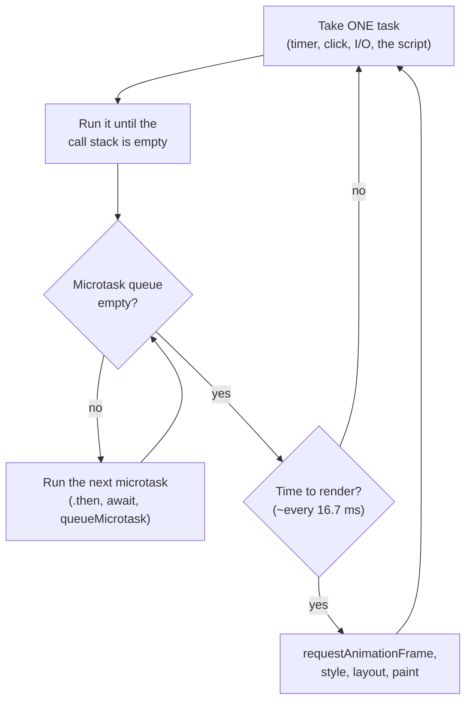

<!-- read-first -->
> [!info] Read first
> [[call-stack|Call stack]] · [[concurrency-vs-parallelism|Concurrency vs parallelism]]
<!-- /read-first -->

The event loop is how a [[thread|single-threaded]] runtime like JavaScript handles many things in progress at once. Slow work
(timers, network, files) is done outside your code; when it finishes, a callback waits in a queue, and the event loop
runs it **only when the [[call-stack|call stack]] is empty**.

## The mental model

Think of one cook (the thread) and a stack of order tickets (the queues). The cook never works on two dishes at the
same instant, and never stops in the middle of a step to start another one. The oven, the fridge and the delivery
driver (the browser, the operating system, the network) work in the background and leave a new ticket when
something is ready. Between steps, the cook looks at the tickets and picks the next one by a fixed rule. That rule is
the event loop.

Two consequences follow, and almost every event-loop question is one of them:

1. **Nothing interrupts running code.** A callback can only start once the code before it has finished and the call
   stack is empty. JavaScript has run-to-completion semantics.
2. **Order is decided by which queue a callback is in,** not by how short its delay is or when it was written.

## How it works

One turn of the loop in a browser, as the HTML Standard describes it:

1. Run the oldest task from a [[task-queue|task queue]] until the call stack is empty.
2. Run every microtask, including microtasks added while doing so, until the [[microtask-queue|microtask queue]] is empty.
3. If it is time to render: `requestAnimationFrame` callbacks, style, layout, paint.
4. Repeat.



The small inner loop (microtasks) must finish completely before the big loop can paint or take another task.

### What goes where

| Queue | What puts a callback there | When it runs |
|---|---|---|
| Task queues | `setTimeout`, `setInterval`, user events, network and file I/O callbacks, `MessageChannel`, the initial script | One per turn of the loop |
| Microtask queue | `.then` / `.catch` / `.finally`, the code after an `await`, `queueMicrotask`, `MutationObserver` | All of them, after every task, until the queue is empty |
| Rendering steps | `requestAnimationFrame` | Before the next paint, when the browser decides to render (usually once per display frame) |

A browser may keep several task queues (for example one for user input, one for timers) and may choose which to
serve first, so input can feel responsive while timers wait. The spec only guarantees order **within** one queue.
Microtasks, by contrast, have one queue and strict first-in, first-out order.

JavaScript itself (the ECMAScript spec) does not define the loop. It defines "jobs", such as the job that runs a
promise reaction, and leaves scheduling to the host. The browser's host is the HTML Standard; Node.js is its own host,
built on the libuv library.

### Where `await` yields

An `async` function runs synchronously up to its first `await`. At that point it returns a pending
[[promise|promise]] to its caller, and the rest of the function is scheduled as a microtask for when the awaited
value is ready. Even `await null` gives up control: the code after it waits for the current synchronous code to
finish and for earlier microtasks to run.

## Example

Predict the order before reading the output.

```js run
setTimeout(() => console.log('task'), 0);
Promise.resolve().then(() => console.log('microtask'));
console.log('sync');
// sync
// microtask
// task
```

The script itself is a task, so `sync` prints first. Then the microtask queue is emptied (`microtask`), and only after
that does the loop take the timer task.

A harder one, with `await` and a microtask that schedules another:

```js run
console.log('A');
setTimeout(() => console.log('F'), 0);
queueMicrotask(() => {
  console.log('C');
  queueMicrotask(() => console.log('E'));
});
(async () => {
  console.log('B');
  await null;
  console.log('D');
})();
// A
// B
// C
// D
// E
// F
```

`B` prints synchronously because an `async` function runs up to its first `await`. At the end of the script, the
microtask queue holds two jobs: the `C` callback, then the continuation after `await` (`D`). Running `C` adds `E` to the
**back** of the queue, behind `D`. The queue is emptied completely, so `E` still runs before the timer task `F`.

## The loop in Node.js

Node.js uses the same idea with named **phases**, each with its own queue of callbacks:

| Phase | What runs |
|---|---|
| timers | Callbacks of `setTimeout` and `setInterval` whose time has come |
| pending callbacks | Some deferred system callbacks, such as certain [[tcp\|TCP]] errors |
| idle, prepare | Internal use only |
| poll | New I/O events; Node may wait here when there is nothing else to do |
| check | `setImmediate` callbacks |
| close callbacks | `close` events, such as `socket.on('close')` |

Between callbacks, Node empties two extra queues: first the `process.nextTick` queue, then the promise microtask
queue. So inside a callback, `nextTick` runs before `.then`.

```js run
import { readFile } from 'node:fs';

readFile(import.meta.filename, () => {
  // we are in the poll phase now; the check phase (setImmediate) comes next
  setTimeout(() => console.log('timeout'), 0);
  setImmediate(() => console.log('immediate'));
  process.nextTick(() => console.log('nextTick'));
  Promise.resolve().then(() => console.log('promise'));
});
// nextTick
// promise
// immediate
// timeout
```

Inside an I/O callback, `setImmediate` always beats `setTimeout(fn, 0)`, because the check phase comes right after
poll and the timers phase only comes around on the next turn. In the main module, outside any I/O callback, their
order is not guaranteed: it depends on whether the 1 ms minimum timer delay has passed when the loop starts.

## Traps

- **`setTimeout(fn, 0)` is a minimum delay, not "now".** The callback waits for the current task and every microtask,
  and it waits longer if the thread is busy:

  ```js run
  const start = Date.now();
  setTimeout(() => console.log('waited at least 50 ms:', Date.now() - start >= 50), 0);
  while (Date.now() - start < 50) {}   // block the thread for 50 ms
  console.log('loop finished');
  // loop finished
  // waited at least 50 ms: true
  ```

  Browsers also clamp nested timers: after several levels of nesting, the minimum delay becomes 4 ms.
- **Endless microtasks starve rendering; endless tasks do not.** A promise chain that keeps adding microtasks never
  lets the loop reach the render step, so the page freezes. A chain of `setTimeout` calls is fine, because the browser
  can paint between tasks. In Node.js, recursive `process.nextTick` starves I/O in the same way.
- **Heavy synchronous code blocks everything,** including clicks, rendering and other timers. Move it to a
  [[web-worker|Web Worker]], or split it into chunks that each run as a separate task.
- **`nextTick` vs promise order depends on module type in Node.js.** In a CommonJS file, top-level `process.nextTick`
  runs before a top-level `.then`. In an ES module (`.mjs`), the module itself is evaluated asynchronously, so the
  promise microtask can run first. Inside callbacks, `nextTick` is always first. Do not write code whose correctness
  depends on this.
- **A `for` loop of `await`s runs one at a time.** Each `await` hands control back to the loop and waits. To run
  independent requests together, start them all first and `await Promise.all(...)`.

## How interviews ask it

- **"Explain the event loop."** Start from the single thread and the call stack, then the two queues, then the rule:
  one task, all microtasks, maybe render. Name where callbacks come from (timers and I/O are tasks; promises and
  `await` are microtasks). Finish with why it matters: long synchronous work blocks the page.
- **"Predict the output"** with `setTimeout`, `.then`, `async` / `await` and `console.log` mixed together. Work in
  three passes: everything synchronous first (including `async` bodies up to the first `await`), then microtasks in
  the order they were queued, adding new ones to the back, then tasks.
- **"Is Node.js single-threaded?"** Your JavaScript runs on one thread. libuv keeps a thread pool for work the
  operating system cannot do asynchronously (file system calls, DNS lookups, some crypto), and the kernel handles
  network I/O. That is why one Node.js process can serve many connections at once, and why a [[cpu|CPU]]-heavy request
  still blocks all of them.

## Related

Lesson: [[2026-11-11-event-loop|#1 · The event loop]]. Spec: [[html-standard-event-loops|HTML Standard: event loops]].
In order: [[how-javascript-runs-your-code|Path: how JavaScript runs your code]].

## Check yourself

> [!question]- What has to be true before a queued callback can run?
> The call stack must be empty. Then all microtasks run first, and only after that the next task.

> [!question]- Why can a page stay responsive while it waits for a network request?
> The request is handled by the browser outside the JavaScript thread. The thread is free until the response's callback is queued and run.

> [!question]- A microtask queues another microtask. Does the new one run before the next `setTimeout` callback?
> Yes. The microtask queue is emptied completely, including microtasks added while it is being emptied, before the
> loop takes the next task.

> [!question]- Inside an `fs.readFile` callback in Node.js, you call `setTimeout(fn, 0)` and `setImmediate(fn)`. Which runs first?
> `setImmediate`. The callback runs in the poll phase, and the check phase, where `setImmediate` callbacks run, comes
> right after it. Timers only run when the loop next reaches the timers phase.

<!-- leads-to -->
## Leads to

- [[html-standard-event-loops|HTML Standard: event loops]]: The section of the HTML Standard (WHATWG) that defines how browsers run tasks, microtasks and rendering.
- [[promise|Promise]]: An object that stands for a result that isn't ready yet. It is pending, then fulfilled with a value or rejected with an error, exactly once.
- [[task-queue|Task queue]]: Where callbacks for timers, events and I/O wait. The event loop runs one task per turn, then all microtasks.
- [[web-worker|Web Worker]]: A real background thread for JavaScript in the browser. It has no DOM access and talks to the page by passing messages.
<!-- /leads-to -->
