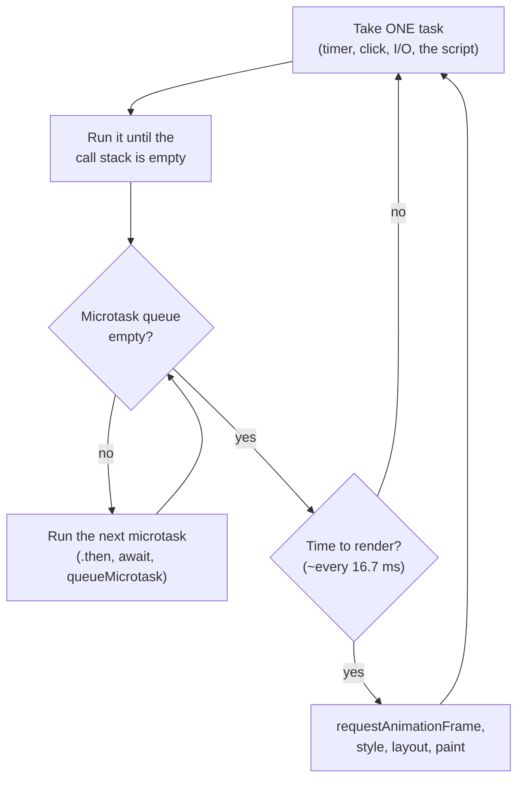

<!-- read-first -->
> [!info] Read first
> [[call-stack|Call stack]] · [[concurrency-vs-parallelism|Concurrency vs parallelism]]
<!-- /read-first -->

The event loop is how a [[thread|single-threaded]] runtime like JavaScript handles many things in progress at once. Slow work
(timers, network, files) is done outside your code; when it finishes, a callback waits in a queue, and the event loop
runs it **only when the [[call-stack|call stack]] is empty**.

## How it works

One turn of the loop in a browser, as the HTML Standard describes it:

1. Run the oldest task from a [[task-queue|task queue]] until the call stack is empty.
2. Run every microtask, including microtasks added while doing so, until the [[microtask-queue|microtask queue]] is empty.
3. If it is time to render: `requestAnimationFrame` callbacks, style, layout, paint.
4. Repeat.



The small inner loop (microtasks) must finish completely before the big loop can paint or take another task.

Node.js uses the same idea but with named phases (timers, poll for I/O, check for `setImmediate`, close callbacks),
and runs `process.nextTick` callbacks and [[promise|promise]] microtasks between callbacks.

## Example

```js run
setTimeout(() => console.log('task'), 0);
Promise.resolve().then(() => console.log('microtask'));
console.log('sync');
// sync
// microtask
// task
```

## Traps

- `setTimeout(fn, 0)` is a minimum delay, not "now".
- Endless microtasks starve rendering; endless tasks do not.
- Heavy synchronous code blocks everything. Move it to a [[web-worker|Web Worker]] or split it into chunks.

## Related

Lesson: [[2026-11-11-event-loop|#1 · The event loop]]. Spec: [[html-standard-event-loops|HTML Standard: event loops]].

## Check yourself

> [!question]- What has to be true before a queued callback can run?
> The call stack must be empty. Then all microtasks run first, and only after that the next task.

> [!question]- Why can a page stay responsive while it waits for a network request?
> The request is handled by the browser outside the JavaScript thread. The thread is free until the response's callback is queued and run.

<!-- leads-to -->
## Leads to

- [[html-standard-event-loops|HTML Standard: event loops]]: The section of the HTML Standard (WHATWG) that defines how browsers run tasks, microtasks and rendering.
- [[promise|Promise]]: An object that stands for a result that isn't ready yet. It is pending, then fulfilled with a value or rejected with an error, exactly once.
- [[task-queue|Task queue]]: Where callbacks for timers, events and I/O wait. The event loop runs one task per turn, then all microtasks.
- [[web-worker|Web Worker]]: A real background thread for JavaScript in the browser. It has no DOM access and talks to the page by passing messages.
<!-- /leads-to -->
