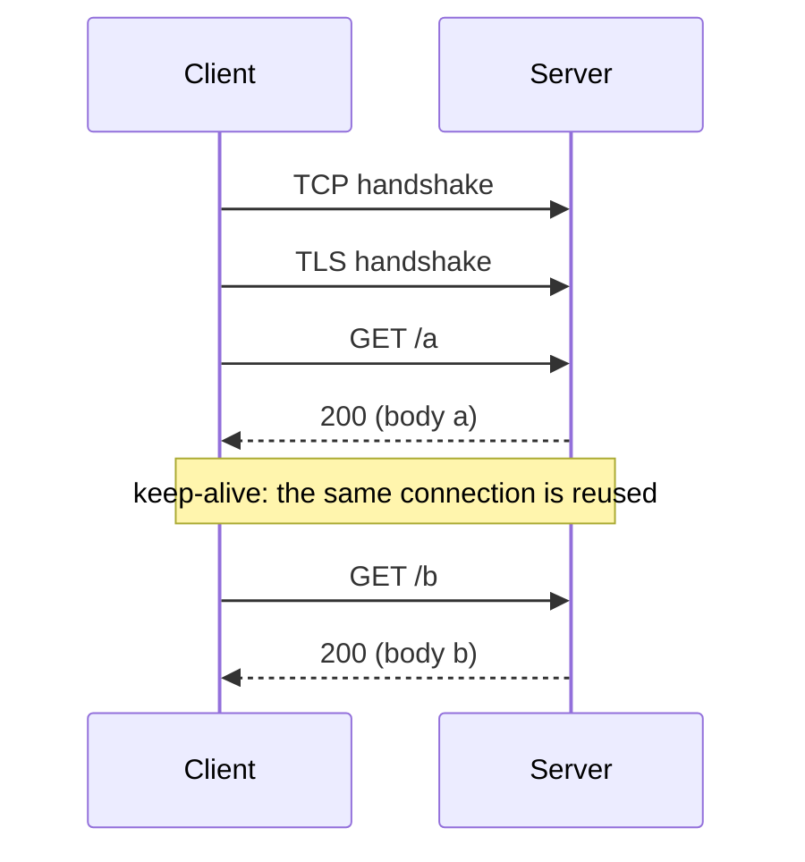

<!-- read-first -->
> [!info] Read first
> [[idempotency|Idempotency]]
<!-- /read-first -->

**HTTP** (HyperText Transfer Protocol) is how a client asks a server for something and gets an answer. The client sends a **request**, the server sends one **response**, and the exchange ends. The server keeps no memory of the client between exchanges, so HTTP is **stateless**. HTTPS is HTTP carried inside an encrypted [[tls|TLS]] connection.

## How it works

A request has a **method** (what to do), a **target** (the path, such as `/items/9`), **headers** (metadata as `name: value` lines) and sometimes a **body**. A response has a **status code**, headers and sometimes a body.

```text
GET /items/9 HTTP/1.1
Host: example.com
Accept: application/json

HTTP/1.1 200 OK
Content-Type: application/json
Content-Length: 18

{"name": "pencil"}
```

The meaning of methods, status codes and headers is defined once, in RFC 9110, and is the same in every version. The versions differ in how the bytes travel:

| Version | Wire format | Parallel requests on one connection |
|---|---|---|
| HTTP/1.1 (RFC 9112) | Text | No: responses come back in order |
| HTTP/2 (RFC 9113) | Binary frames in streams, compressed headers | Yes, over one [[tcp\|TCP]] connection |
| HTTP/3 (RFC 9114) | Binary frames over QUIC | Yes, and a lost packet only delays its own stream |

HTTP/1.1 keeps a connection open by default (**keep-alive**), so the cost of the TCP and TLS handshakes is paid once, not for every request.

## Example

```py run
import socket, threading
from http.server import BaseHTTPRequestHandler, HTTPServer

class H(BaseHTTPRequestHandler):
    def do_GET(self):
        body = b"hello"
        self.send_response(200)
        self.send_header("Content-Length", str(len(body)))
        self.end_headers()
        self.wfile.write(body)
    def log_message(self, *a):
        pass

srv = HTTPServer(("127.0.0.1", 0), H)
threading.Thread(target=srv.serve_forever, daemon=True).start()
s = socket.create_connection(srv.server_address)
s.sendall(b"GET / HTTP/1.1\r\nHost: x\r\nConnection: close\r\n\r\n")
data = b""
while chunk := s.recv(1024):
    data += chunk
print(data.decode().splitlines()[0])   # HTTP/1.0 200 OK  (this server speaks 1.0 unless you set 1.1)
print(data.split(b"\r\n\r\n")[1])      # b'hello'
srv.shutdown()
```

## Methods: what each one promises

RFC 9110 gives each method a contract. Two words matter. A **safe** method must not change anything on the server
that the client is responsible for. An **idempotent** method has the same effect whether you send it once or ten
times (see [[idempotency|idempotency]]).

| Method | Meaning | Safe | Idempotent |
|---|---|---|---|
| GET | Read a resource | Yes | Yes |
| HEAD | Like GET, headers only | Yes | Yes |
| OPTIONS | Ask what is allowed | Yes | Yes |
| PUT | Replace a resource with this body | No | Yes |
| DELETE | Remove a resource | No | Yes |
| POST | Process this body (create, run an action) | No | No |
| PATCH | Change part of a resource | No | Not by definition |

This table is why a client or proxy may retry a failed `GET` or `PUT` on its own, and must be careful about a
failed `POST`: if the connection dies after the request is sent, you do not know if the server acted. A payment
API solves that with an idempotency key, a header the client chooses, so the server can spot a repeat.

## Headers that do real work

Headers are `name: value` lines, and a few of them carry most of the behaviour.

- **Host** names the site. It lets one server and one IP address serve many sites, and HTTP/1.1 requires it.
- **Content-Type** and **Accept** say what the body is and what the client can read (content negotiation).
- **Content-Length** or **Transfer-Encoding: chunked** tell the receiver where the body ends. Without one of them a
  connection could not be reused, because the next response would not know where to start.
- **Cache-Control** says how long a response may be reused, and by whom (RFC 9111). With `max-age=60` a cache may
  serve the response for 60 seconds without asking again.
- **ETag** and **If-None-Match** make revalidation cheap. The server tags a response (`ETag: "v7"`). Later the client
  asks `If-None-Match: "v7"`. If nothing changed, the server replies `304 Not Modified` with no body.
- **Authorization** and **Cookie** carry identity, since the protocol itself remembers nothing.

## Connections, and why the versions exist

Each request needs a connection, and a new one costs a [[tcp|TCP]] handshake plus a [[tls|TLS]] handshake, a few
round trips before the first byte of the request. Every version of HTTP is a different answer to "how do we pay that
cost less often?"

**HTTP/1.0** opened one connection per request. **HTTP/1.1** keeps the connection open and reuses it, but only one
request can be in flight at a time on it, so a slow response blocks the ones behind it. That is **head-of-line
blocking** at the HTTP level. Browsers worked around it by opening about six connections per host, and sites by
bundling files and spreading assets over several hostnames.

**HTTP/2** (RFC 9113) splits traffic into small binary **frames** that belong to numbered **streams**. Many streams
share one connection and their frames are interleaved, so a slow response no longer blocks the others (this is
**multiplexing**). It also compresses headers with HPACK (RFC 7541), because the same long `Cookie` and `User-Agent`
lines repeat on every request. Its remaining weakness is below HTTP: TCP delivers bytes in order, so one lost packet
stalls every stream on the connection until it is resent.

**HTTP/3** (RFC 9114) runs over **QUIC** (RFC 9000), which is built on UDP. QUIC has its own streams and encryption,
and a lost packet delays only the stream it belonged to. It also sets up the connection and the encryption together,
saving a round trip, and a connection can survive a phone moving from Wi-Fi to mobile data.



You can see reuse in code. With `http.client`, the second request goes over the same socket as the first:

```py run
import http.client, threading
from http.server import BaseHTTPRequestHandler, HTTPServer

class H(BaseHTTPRequestHandler):
    protocol_version = "HTTP/1.1"          # keep-alive needs 1.1 and a Content-Length
    def do_GET(self):
        body = f"you asked for {self.path}".encode()
        self.send_response(200)
        self.send_header("Content-Length", str(len(body)))
        self.send_header("Cache-Control", "max-age=60")
        self.end_headers()
        self.wfile.write(body)
    def do_POST(self):
        self.rfile.read(int(self.headers.get("Content-Length", 0)))
        self.send_response(201)
        self.send_header("Content-Length", "0")
        self.end_headers()
    def log_message(self, *a):
        pass

srv = HTTPServer(("127.0.0.1", 0), H)
threading.Thread(target=srv.serve_forever, daemon=True).start()

conn = http.client.HTTPConnection(*srv.server_address)
conn.request("GET", "/a")
r = conn.getresponse()
print(r.status, r.getheader("Cache-Control"), r.read())   # 200 max-age=60 b'you asked for /a'
first_socket = conn.sock
conn.request("GET", "/b")
conn.getresponse().read()
print(conn.sock is first_socket)                          # True   same connection reused
conn.request("POST", "/items", body=b"{}")
r = conn.getresponse()
r.read()
print(r.status)                                           # 201
conn.close()
srv.shutdown()
```

## Edge cases

- **Redirects.** `301` and `302` may turn a `POST` into a `GET` in older clients; `307` and `308` keep the method.
  Use those when the method must survive.
- **Request smuggling.** If two machines in a chain disagree on where one request ends (one trusts `Content-Length`,
  the other `Transfer-Encoding`), an attacker can hide a second request inside the first. Servers should reject
  requests that carry both, and RFC 9112 says how.
- **Timeouts and retries.** A client that retries a non-idempotent request after a timeout can do the work twice.
  Retry only idempotent methods, or add an idempotency key.
- **Large uploads.** A server can answer `413` before it reads the body, and a client can send `Expect: 100-continue`
  to ask whether to send a big body at all.
- **Server push** in HTTP/2 let a server send files before they were asked for. It proved hard to use well, and
  browsers have been dropping support; do not design around it.

## How interviews ask it

> [!question]- "What happens between typing a URL and seeing the page, at the HTTP level?"
> The browser resolves the host name, opens a TCP connection and, for HTTPS, a TLS handshake. It sends `GET /` with a `Host` header. The server replies with a status line, headers and the HTML. The browser parses it, finds more resources (scripts, styles, images) and fetches them, reusing the connection or multiplexing them over one HTTP/2 connection. Cache headers decide which of those it can skip.

> [!question]- "Why is POST not safe to retry, and how do you make it safe?"
> `POST` is not idempotent: sending it twice can create two orders. If a timeout hides whether the first one arrived, a blind retry may duplicate it. Make the request idempotent: the client sends a unique idempotency key, and the server stores the result under it and returns the stored result for a repeat.

## Related reading

[[2026-11-18-http|Lesson 5]] is the guided walk-through, and the [[http-status-codes|status code]] note covers the
numbers. The primary sources are RFC 9110 (semantics), 9111 (caching), 9112 (HTTP/1.1), 9113 (HTTP/2) and 9114
(HTTP/3).

## Traps

- Statelessness does not mean no state: cookies and [[token|tokens]] carry state with each request.
- A `GET` must not change data. Robots and prefetchers send `GET` freely.
- The status code is the contract. A `200` with an error message in the body hides failures from clients and monitoring.
- A `404` from a typo and a `404` from a deleted record look the same; log the cause, not just the code.
- Versions change performance, not meaning. Code written against methods and status codes works on all three.

## Related

[[idempotency|Idempotency]] decides which requests are safe to retry. [[http-status-codes|Status codes]] tell the client what happened. The full walk-through is in [[2026-11-18-http|lesson 5]]. [[microservices|Microservices]] talk to each other mostly over HTTP.

## Check yourself

> [!question]- What does it mean that HTTP is stateless?
> Each request carries everything the server needs; the server does not remember earlier requests from the same client. State, such as a login, is carried by the client in cookies or tokens on each request.

> [!question]- What stays the same and what changes between HTTP/1.1 and HTTP/2?
> The semantics stay: methods, status codes and headers mean the same. The wire format changes from text to binary frames, and many requests can share one connection at once.

<!-- leads-to -->
## Leads to

- [[2026-11-18-http|#5 · HTTP in depth]]: What an HTTP request and response really are, which methods are safe and idempotent, the status codes that matter, and how keep-alive and HTTP/2 make it faster.
- [[http-status-codes|HTTP status codes]]: The three-digit number in an HTTP response that tells the client what happened, grouped by the first digit into success, redirect, client error and server error.
- [[idempotency|Idempotency]]: An operation is idempotent if doing it many times leaves the system in the same state as doing it once, which is what makes retries safe.
<!-- /leads-to -->
