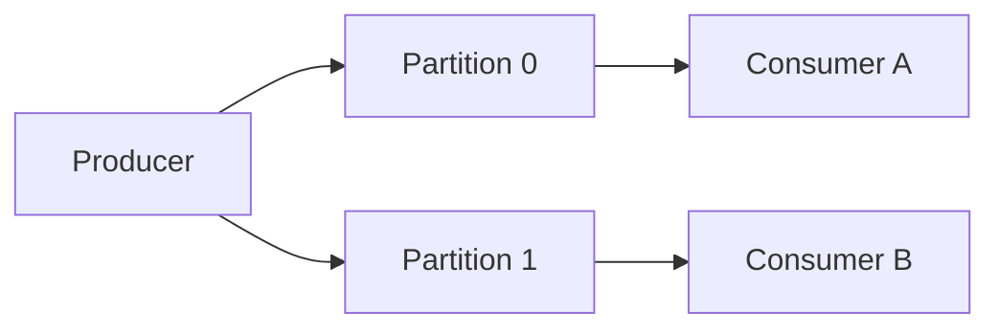

<!-- read-first -->
> [!info] Read first
> [[microservices|Microservices]]
<!-- /read-first -->

Kafka is a system for moving streams of records between programs. It began at LinkedIn and is now an Apache project.
Think of it as a very large, replicated, append-only file that many readers can read at their own pace.

## How it works

- A **record** is a key, a value and a timestamp.
- Records go into a **topic**, which is split into **partitions**. Each partition is an ordered log: new records are
  added at the end, and each gets a number called its **offset**.
- Order is guaranteed **within** a partition, not across the whole topic. Records with the same key go to the same
  partition, so one key's events stay in order.
- A **consumer** reads a partition by asking for records from an offset, and remembers how far it got. Reading does
  not delete anything. Records are removed by a **retention** rule (age or size).
- Consumers join a **consumer group**. The partitions of a topic are divided among the group's members, and each
  partition is read by one member of the group at a time. Add consumers to read faster, up to the partition count.
- Partitions are **replicated** on several brokers, so a broker crash does not lose records.

## Why job posts ask for it

Kafka is the backbone for event-driven [[microservices|microservices]]: services publish events instead of calling
each other, and any number of others read them later. It also feeds analytics and data pipelines.

## Traps

- No global order across partitions. Choose the key so that events that must stay in order share a key.
- Consumers get records **at least once** by default; after a crash a record can be seen twice, so handle repeats
  (see [[idempotency|idempotency]]).
- A slow consumer does not slow producers; it just falls behind, which you see as lag (the gap between the newest
  offset and its offset).

## Related

A consumer loop is an [[iterator|iterator]] over an endless stream: `for record in consumer:` pulls records lazily.

## Check yourself

> [!question]- Two events for the same user must be processed in order. How do you arrange that in Kafka?
> Use the user id as the record key, so all of that user's events go to the same partition, where order is kept.

> [!question]- A consumer reads a record. Is the record deleted?
> No. It stays until the retention rule removes it, so other groups can read it and a consumer can re-read from an earlier offset.
