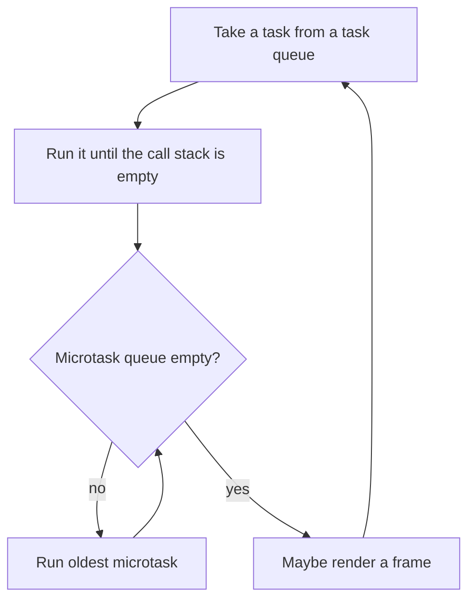

<!-- read-first -->
> [!info] Read first
> [[task-queue|Task queue]] · [[promise|Promise]]
<!-- /read-first -->

Microtasks are small jobs that must run **as soon as the current task finishes**, before the next task and before the
next paint. They are why [[promise|promise]] callbacks run before timers.

## What goes in it

- Promise reactions: `.then`, `.catch`, `.finally` callbacks.
- The rest of an `async` function after an `await`.
- `queueMicrotask(fn)`.
- `MutationObserver` callbacks.

## How it works

After each task, the [[event-loop|event loop]] runs microtasks until the queue is **empty**, including any microtasks
that those microtasks add. Only then does it render or take another task.

```js run
queueMicrotask(() => {
  console.log('first');
  queueMicrotask(() => console.log('added during the drain'));
});
setTimeout(() => console.log('task'), 0);
// first
// added during the drain
// task
```

### The microtask checkpoint

The [[html-standard-event-loops|HTML standard]] calls the drain a **microtask checkpoint**. The steps are simple: while the microtask queue is not
empty, take the oldest microtask and run it. If one throws, the error is reported and the loop carries on with the
next one. A checkpoint does not start while a microtask checkpoint is already running, which is what stops
re-entrancy.

A checkpoint happens whenever the JavaScript [[call-stack|call stack]] becomes empty. That is more often than "after each task":

- After a task's main script or callback finishes (a timer callback, a message event, a fetch completion).
- After **each event listener callback** when the browser dispatches a real user event. If a button has two click
  listeners, microtasks queued by the first run before the second listener starts. When your own code calls
  `button.click()`, the stack is not empty (your code is still on it), so both listeners run first and the
  microtasks wait.
- After a `<script>` element finishes running.



### Order inside one script

Predict the order before you run this. The synchronous lines come first, then microtasks in the order they were
queued, then the timer task.

```js run
console.log('1 script start');
setTimeout(() => console.log('7 timeout'), 0);
async function f() {
  console.log('2 f start');
  await null;
  console.log('5 f after await');
}
f();
new Promise((resolve) => {
  console.log('3 executor runs synchronously');
  resolve();
}).then(() => console.log('6 then'));
queueMicrotask(() => console.log('6b queueMicrotask'));
console.log('4 script end');
// 1 script start
// 2 f start
// 3 executor runs synchronously
// 4 script end
// 5 f after await
// 6 then
// 6b queueMicrotask
// 7 timeout
```

Two details worth noting. The code before the first `await` in an [[async-await|async function]], and the executor passed to
`new Promise`, run synchronously. Only the continuation is a microtask. And microtasks run in first-in, first-out
order, so `f`'s continuation (queued first) runs before the `.then` callback (queued second).

### How many ticks does an `await` take?

Each promise reaction is one microtask, so the number of "ticks" a pattern takes shows up as ordering. Awaiting or
returning a plain value takes one tick. Returning a **promise** from an async function costs extra ticks, because the
outer promise has to be resolved with another promise, and that takes additional microtask jobs.

```js run
const order = [];
async function returnsPromise() {
  return Promise.resolve('x');
}
async function returnsValue() {
  return 'x';
}
returnsPromise().then(() => order.push('A: async fn returning a promise'));
returnsValue().then(() => order.push('B: async fn returning a value'));
Promise.resolve().then(() => order.push('t1')).then(() => order.push('t2')).then(() => order.push('t3'));
setTimeout(() => console.log(order), 0);
// [ 'B: async fn returning a value', 't1', 't2', 'A: async fn returning a promise', 't3' ]
```

A, which returns a promise, arrives after `t2`, about two ticks later than B. You should almost never depend on this,
but it explains why two chains that look equal can interleave in a surprising way, and it is a favourite interview
puzzle.

### What happens when a microtask throws

An error inside a microtask does not stop the others.

```js run
const log = [];
process.on('uncaughtException', (e) => log.push('reported: ' + e.message));
queueMicrotask(() => { throw new Error('boom'); });
queueMicrotask(() => log.push('still runs'));
setTimeout(() => console.log(log), 0);
// [ 'reported: boom', 'still runs' ]
```

In a browser the error goes to `window.onerror`; in Node it is an uncaught exception. Inside promise callbacks the
error does not throw at all: it rejects the promise that `.then` returned. If nothing handles that rejection, the
host reports an unhandled rejection. Hosts decide when to check for this, usually after the microtask queue has
drained, which is why a `.catch` added in a later microtask can still be in time but one added in a later task is not.

## Starvation

Because the checkpoint runs until the queue is empty, a microtask that keeps queueing microtasks never lets the loop
move on. No task runs, no frame paints, no click is handled. Compare:

```js
// Freezes the page: the microtask queue never empties.
function spin() { queueMicrotask(spin); }
spin();

// Does not freeze: each callback is a separate task, so the browser can paint between them.
function tick() { setTimeout(tick, 0); }
tick();
```

The fix for long work is to split it and hand control back with a task (`setTimeout`, `MessageChannel`, or
`scheduler.postTask` where available), not with a microtask. Microtasks are the right tool for the opposite job:
finishing small bookkeeping before anything else can observe the state, such as batching several synchronous updates
into one flush.

## Node.js differences

- `process.nextTick` callbacks have their own queue, and it runs **before** promise microtasks.
- Since Node 11, microtasks run between individual timer callbacks, matching browsers. Earlier versions ran all due
  timers first.

```js run
Promise.resolve().then(() => console.log('promise'));
process.nextTick(() => console.log('nextTick'));
console.log('sync');
// sync
// nextTick
// promise
```

```js run
setTimeout(() => { console.log('timeout 1'); Promise.resolve().then(() => console.log('micro after 1')); }, 0);
setTimeout(() => console.log('timeout 2'), 0);
// timeout 1
// micro after 1
// timeout 2
```

Node's own docs advise preferring `queueMicrotask` or promises over `nextTick` in new code, because a recursive
`nextTick` can starve I/O in the same way a recursive microtask starves rendering.

## Traps

- A microtask that keeps scheduling microtasks blocks the page completely: no paint, no input.
- In Node.js, `process.nextTick` callbacks have their own queue that runs **before** promise microtasks.
- Awaiting a value that is already available still yields. `await` always gives other microtasks queued earlier a chance
  to run first.
- Do not rely on exact tick counts between two promise chains. The numbers can differ between engines and versions.
- A heavy synchronous loop inside a `.then` callback is still a long task. Putting work in a microtask makes it run
  earlier, not off the [[thread|main thread]]. For that you need a [[web-worker|web worker]].
- `queueMicrotask` is not a delay. If you want the browser to render before your code runs, you need a task or
  `requestAnimationFrame`, not a microtask.

## How interviews ask it

> [!question]- "What is the output of a script with a timer, a promise and `console.log`, and why?"
> Synchronous logs first. Then the promise callback, because the microtask queue is drained right after the script
> finishes. Then the timer, which is a separate task that waits for a later turn of the loop. Say the rule out loud:
> the stack empties, then all microtasks, then render, then the next task.

> [!question]- "Can a promise chain freeze the browser?"
> Yes. The queue must be empty before the loop moves on, so an endless chain of promise callbacks never lets it
> paint or handle input. An endless chain of `setTimeout` calls does not, because each callback is a separate task.

## Check yourself

> [!question]- Why does `.then` run before `setTimeout(fn, 0)`?
> `.then` callbacks are microtasks, and the microtask queue is emptied right after the current task; the timer callback is a separate task that waits for a later turn.

> [!question]- What happens if microtasks keep adding microtasks forever?
> The queue never empties, so the browser never renders or handles input: the page freezes.

> [!question]- In a browser, a button has two click listeners and the first queues a microtask. When does it run for a real click versus for `button.click()` called from code?
> For a real click, between the two listeners, because the stack is empty after the first one returns. For `button.click()`
> from your code, after both listeners, because your calling code is still on the stack.

<!-- leads-to -->
## Leads to

- [[async-await|async / await]]: Syntax that lets promise-based code read top to bottom. An async function always returns a promise; await pauses only that function.
<!-- /leads-to -->
