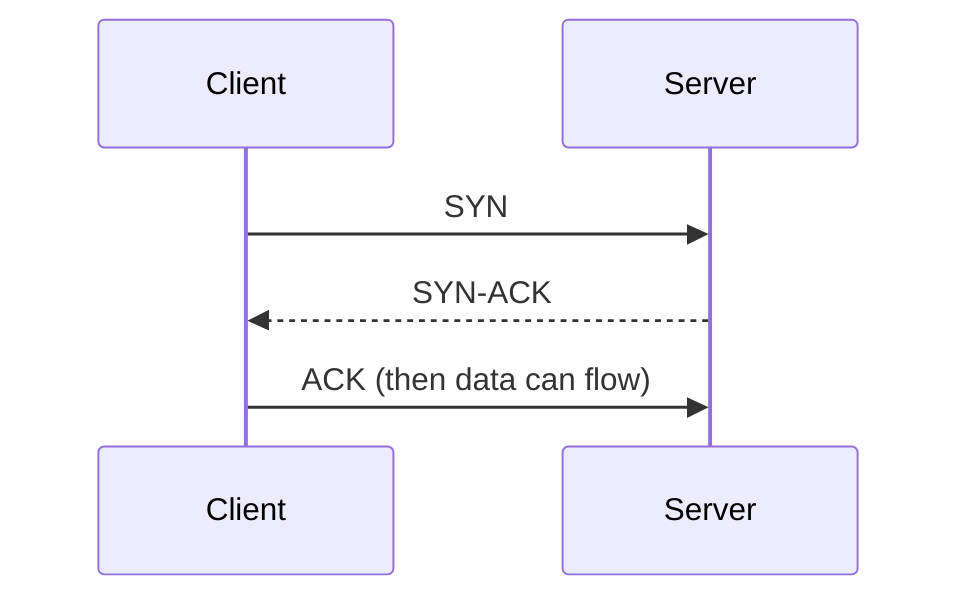

The network itself (IP) only [[promise|promises]] to *try* to deliver packets. They can be lost, duplicated or arrive out of
order. **TCP** (Transmission Control Protocol, currently specified in RFC 9293) runs on both machines and hides all
of that: each side sees a **reliable, ordered stream of bytes**. Most of the internet's application protocols,
including [[http|HTTP]]/1.1 and HTTP/2, run on top of it.

## How it works

- **Ports.** A connection is identified by four values: client IP and port, server IP and port. That is how one
  server process on port 443 can hold thousands of connections.
- **Three-way handshake.** The client sends `SYN`, the server answers `SYN-ACK`, the client sends `ACK`. Both sides
  now agree on starting sequence numbers. This costs one round trip before any data moves.
- **Sequence numbers and acknowledgements.** Every byte has a number. The receiver acknowledges what it has received;
  anything not acknowledged in time is sent again. The receiver puts bytes back in order before handing them over.
- **Flow control.** The receiver advertises how much buffer space it has (the window), so a fast sender can't swamp
  a slow reader.
- **Congestion control.** The sender starts slowly and increases its rate until packets are lost, then backs off
  (RFC 5681). This is why a new connection is slower than a warmed-up one.
- **Closing.** Each side sends `FIN` for its direction. The side that closes first waits a while in `TIME_WAIT` so
  that late packets from the old connection are not mistaken for a new one.



## Example

TCP is a byte **stream**, not a sequence of messages. Two separate sends can arrive as one read:

```py run
import socket, threading

server = socket.create_server(("127.0.0.1", 0))
port = server.getsockname()[1]
received = []

def serve():
    conn, _ = server.accept()
    with conn:
        data = b""
        while chunk := conn.recv(1024):    # read until the client closes
            data += chunk
        received.append(data)

t = threading.Thread(target=serve)
t.start()
with socket.create_connection(("127.0.0.1", port)) as c:
    c.sendall(b"hello")
    c.sendall(b"world")
t.join()
server.close()
print(received[0])    # b'helloworld': the boundary between the two sends is gone
```

That is why protocols on TCP mark where each message ends: HTTP/1.1 uses `Content-Length` or chunked encoding;
many binary protocols put a length in front of every message.

## Traps

- **Assuming one `send` equals one `recv`.** Reads can return part of a message or several messages. Always frame.
- **Reliable does not mean delivered.** TCP retries, but if the connection breaks, data in flight is lost and the
  sender may not know whether the other side processed it. That is why [[idempotency|idempotency]] matters.
- **Head-of-line blocking.** Because bytes are delivered in order, one lost packet stalls everything behind it on that
  connection. HTTP/3 moves to QUIC over UDP partly for this reason.

## Related

[[http|HTTP]] · [[tls|TLS]] (the encryption layer on top) · [[2026-11-18-http|#5 · HTTP in depth]]

## Check yourself

> [!question]- How many round trips does a TCP connection cost before the first byte of data can be sent?
> One: the `SYN` / `SYN-ACK` exchange. The client's final `ACK` can travel together with its first data.

> [!question]- Your server reads `recv(1024)` once and parses the result as one JSON message. Why does it fail sometimes?
> TCP does not keep message boundaries. A read can return half a message, or two messages glued together. Add framing,
> such as a length prefix, and read until the whole message has arrived.

<!-- leads-to -->
## Leads to

- [[tls|TLS]]: The protocol that encrypts a connection and proves the server's identity with a certificate; it is the S in HTTPS.
<!-- /leads-to -->
