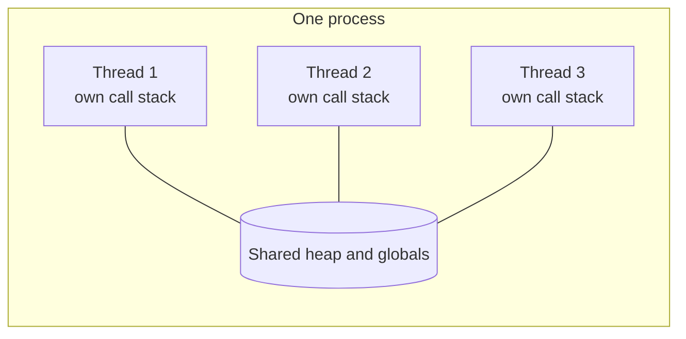

<!-- read-first -->
> [!info] Read first
> [[call-stack|Call stack]]
<!-- /read-first -->

A thread is one line of execution inside a program. A **process** is a running program with its own memory; it has
at least one thread, and can have many. Threads in the same process **share memory** (the heap, global variables)
but each has its **own** [[call-stack|call stack]].

## How it works

- The operating system scheduler switches between threads (a context switch) many times a second. On a machine with several [[cpu|CPU cores]], threads can also run truly at the same moment.
- Sharing memory makes threads cheap to communicate, and dangerous: two threads changing the same data can interleave in surprising ways (a race condition). Locks prevent that, and bring their own problem (deadlock).

## In the languages you use

| Language | Threads |
|---|---|
| JavaScript | Your code runs on one main thread; the [[event-loop\|event loop]] gives it [[concurrency-vs-parallelism\|concurrency]]. Real extra threads come from [[web-worker\|Web Workers]] (browser) or `worker_threads` (Node), which don't share normal variables. |
| Python (CPython) | Real OS threads, but the GIL lets only one run Python bytecode at a time, so threads help with waiting (I/O), not with CPU-heavy work. Python 3.13 added an optional [[gil\|free-threaded]] build without the GIL (PEP 703). |
| [[java\|Java]], C# | Real threads that run in parallel on multiple cores, plus thread pools and higher-level tools. |

## Process, thread, and what each one owns

A process is the operating system's unit of isolation. It gets its own virtual address space, its open files, and
at least one thread. A thread is the unit the scheduler actually runs. Splitting the two lets the OS keep programs
away from each other (one crashing process cannot overwrite another's memory) while letting the threads inside one
program work together cheaply.

| | Process | Thread |
|---|---|---|
| Memory | Its own address space | Shares the process's heap and globals |
| Call stack | One per thread | Its own |
| Cost to create | Higher (new address space, new tables) | Lower |
| Talking to another one | Pipes, sockets, shared memory, queues | Read and write the same objects |
| If it crashes | Other processes carry on | Can take down the whole process |

The cost of sharing is that **you** now have to keep shared data consistent. That is the whole difficulty of
threads, and the rest of this note is about it.



## Why a second thread helps

Threads buy you two different things, and mixing them up causes most bad designs.

1. **Waiting in parallel.** A program that calls a slow API, a database or a disk spends most of its time doing
   nothing. While one thread waits, another can run. The work is I/O-bound, so even one CPU core benefits.
2. **Computing in parallel.** If the work is arithmetic, more threads help only when they run at the same instant
   on different cores. That is parallelism, and it depends on the language runtime: Java and C# allow it,
   standard CPython does not (see the [[gil|GIL]]).

Asking "is my task waiting or computing?" picks the tool: threads or async for waiting, processes or a runtime
without a global lock for computing. [[concurrency-vs-parallelism|Concurrency vs parallelism]] covers the
vocabulary.

## What the scheduler does to your code

The OS scheduler decides which thread runs and for how long. It can pause a thread at almost any point, then run
another one, then come back. You do not control when. This is called **preemption**, and it is why the same
program can behave differently from one run to the next.

A **context switch** saves one thread's registers and stack pointer and loads another's. It is cheap compared with
a process switch, but not free: the CPU caches are often cold afterwards, so thousands of threads doing tiny jobs
spend a lot of time switching instead of working. This is why servers use a **thread pool** of a fixed size and
feed it tasks, instead of creating a thread per request.

## Shared memory and the race condition

A **race condition** is a bug where the result depends on the order in which threads happen to run. The classic
case is a read-modify-write on shared data. `counter += 1` looks like one step, but it is three: read the value,
add one, write it back. If two threads both read `5`, both write `6`, one increment is lost.

```py
import threading

counter = 0

def work():
    global counter
    for _ in range(100_000):
        counter += 1          # read, add, write: not atomic

threads = [threading.Thread(target=work) for _ in range(4)]
for t in threads: t.start()
for t in threads: t.join()
print(counter)                # may be less than 400000; it can differ on every run
```

This snippet is left without `run` on purpose: its output is not stable. Whether you see lost updates depends on
the Python version and on timing. In the free-threaded build they are easy to hit; in the default build the GIL
switches threads only at certain points, which hides the bug much of the time, but the language does not [[promise|promise]]
that. Code that is correct only by luck is still a bug.

The fix is a **lock** (also called a mutex): only the thread holding it may enter the protected section, and the
others wait.

```py run
import threading

counter = 0
lock = threading.Lock()

def work():
    global counter
    for _ in range(100_000):
        with lock:            # acquire, then always release, even on error
            counter += 1

threads = [threading.Thread(target=work) for _ in range(4)]
for t in threads: t.start()
for t in threads: t.join()
print(counter)                # 400000, every run
```

Keep the locked section **small**. A lock around a network call makes every other thread wait for the network.

## Deadlock

A **deadlock** is when threads wait for each other forever. The standard recipe uses two locks. Thread A holds
lock 1 and wants lock 2. Thread B holds lock 2 and wants lock 1. Neither can move.

```py
# Do not run: this can hang forever.
import threading
a, b = threading.Lock(), threading.Lock()

def first():
    with a:
        with b: pass          # takes a, then b

def second():
    with b:
        with a: pass          # takes b, then a: opposite order
```

Four conditions must all hold for a deadlock: locks are exclusive, a thread holds one while waiting for another, a
lock cannot be taken away, and the waits form a cycle. Break any one. The cheapest fix in practice is to give all
locks a **global order** and always take them in that order.

```py run
import threading
a, b = threading.Lock(), threading.Lock()
log = []

def worker(name):
    with a:                   # everyone takes a first, then b
        with b:
            log.append(name)

ts = [threading.Thread(target=worker, args=(i,)) for i in range(3)]
for t in ts: t.start()
for t in ts: t.join()
print(sorted(log))            # [0, 1, 2]: no deadlock
```

## Safer than locks: do not share

Most thread bugs come from many threads touching the same mutable data. So the best design often avoids sharing.

- **Message passing.** Threads hand each other work through a thread-safe queue and never touch each other's data.
  Python's `queue.Queue` does its own locking.
- **Immutable data.** Data that never changes cannot race. See [[mutability|mutability]].
- **Thread-local data.** Each thread gets its own copy (`threading.local`).
- **Higher-level tools.** `concurrent.futures.ThreadPoolExecutor` runs tasks on a pool and returns results as
  futures, so you rarely touch a lock yourself.

```py run
import queue, threading

jobs = queue.Queue()
results = queue.Queue()

def worker():
    while True:
        n = jobs.get()
        if n is None:         # sentinel: no more work
            break
        results.put(n * n)

t = threading.Thread(target=worker)
t.start()
for n in [1, 2, 3, 4]:
    jobs.put(n)
jobs.put(None)
t.join()
print([results.get() for _ in range(4)])   # [1, 4, 9, 16]
```

One consumer thread keeps the output in order. With several workers the order of results would vary, which is
normal: do not rely on the order threads finish.

## The stack is private, the heap is not

Every function call inside a thread pushes a frame on **that thread's** stack, so local variables are safe from other
threads. The danger is objects on the heap that more than one thread can reach: globals, module-level state,
anything you pass to a thread by reference. A useful review question is "which objects can two threads both reach,
and does any thread change them?" If no thread changes them, there is no race.

## Where to read more

Thread bugs are hard to find because they depend on timing, so they often pass tests and fail under load. The
Python documentation for `threading` and `queue` is a good primary reference for the tools above, and the Java
Language Specification, chapter 17, defines precisely what one thread is guaranteed to see of another's writes
(the memory model). Read it once if you will write Java: without synchronisation, one thread may not see another's
update at all.

## Traps

- **"It worked when I ran it"** is not evidence. Races are about rare timings.
- **`join()` forgotten:** the main thread may exit, or read results, before workers finish.
- **Locks held across slow calls:** you turn a parallel program back into a serial one.
- **Threads for CPU work in CPython:** with the GIL they add overhead and no speed-up. Use `multiprocessing` or the free-threaded build.
- **Shared mutable defaults and globals:** the same trap as in [[mutability|mutable default arguments]], now with timing on top.
- **Unbounded thread creation:** one thread per request can exhaust memory (each thread reserves stack space). Use a pool.

## Interview angle

Likely questions: process vs thread; what a race condition is and how to prevent it; what a deadlock is and how to
avoid it; why Python threads do not speed up CPU work; when to choose threads, processes or async. A strong answer
names the shared resource, says what the failure looks like (lost update, hang), and gives the smallest fix: a lock
around the critical section, a global lock order, or removing the sharing with a queue.

## Example

```py run
import threading, time

def fetch(name):
    time.sleep(0.2)          # stands in for a network call; the GIL is released while waiting
    print("done", name)

start = time.time()
threads = [threading.Thread(target=fetch, args=(i,)) for i in range(3)]
for t in threads: t.start()
for t in threads: t.join()
print(round(time.time() - start, 1) < 0.5)   # True: the three waits overlapped
```

## Check yourself

> [!question]- What do two threads of the same process share, and what don't they share?
> They share the process's memory (heap, globals). Each has its own call stack and registers.

> [!question]- Why don't Python threads speed up a CPU-heavy loop in standard CPython?
> The GIL lets only one thread execute Python bytecode at a time. Use processes (multiprocessing) or the free-threaded build instead.

> [!question]- Two threads each run `counter += 1` a million times on a shared counter, with no lock. Why can the total come out too low?
> `counter += 1` is read, add, write. If both threads read the same value before either writes, one increment is lost. A lock around the update makes the three steps happen as one.

> [!question]- How do you stop two threads from deadlocking on two locks?
> Make every thread take the locks in the same global order (say `a` before `b`). Then no cycle of waiting can form. Holding locks for as short a time as possible also helps.

> [!question]- You need to download 200 web pages in Python. Threads, processes or async, and why?
> Threads or async. The work is waiting on the network, and the GIL is released while a thread waits. Processes would work but cost more memory for no gain.

<!-- leads-to -->
## Leads to

- [[2026-11-11-event-loop|#1 · The event loop]]: How JavaScript does many things at once with one thread, and why promise callbacks run before timers.
- [[concurrency-vs-parallelism|Concurrency vs parallelism]]: Concurrency is dealing with many things in progress at once; parallelism is doing many things at the same instant.
- [[gil|GIL (Global Interpreter Lock)]]: A lock in CPython that lets only one thread run Python bytecode at a time. Python 3.13 added an optional build without it.
- [[web-worker|Web Worker]]: A real background thread for JavaScript in the browser. It has no DOM access and talks to the page by passing messages.
<!-- /leads-to -->
