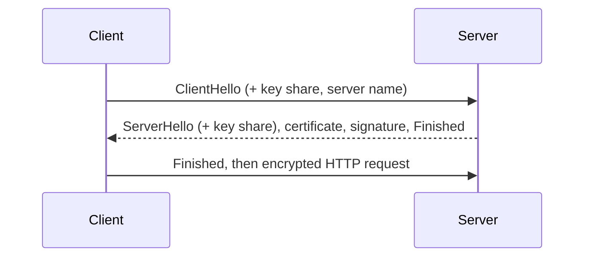

<!-- read-first -->
> [!info] Read first
> [[tcp|TCP]]
<!-- /read-first -->

[[tcp|TCP]] delivers bytes reliably, but anyone on the path can read or change them. **TLS** (Transport Layer
Security; version 1.3 is RFC 8446) sits between TCP and the application and gives three things:

- **Confidentiality:** the bytes are encrypted.
- **Integrity:** any change in transit is detected.
- **Authentication:** the client can check it is talking to the real server, using a certificate.

HTTPS is [[http|HTTP]] inside TLS. "SSL" is the name of TLS's long-retired predecessor; people still say it, but
every SSL version is deprecated.

## How it works

The TLS 1.3 handshake takes one round trip on top of the TCP handshake:

1. **ClientHello:** the client lists the cipher suites it supports and sends a key share (its half of a
   Diffie-Hellman key exchange), plus the server name it wants (SNI).
2. **ServerHello and the rest:** the server picks a cipher suite and sends its own key share. Both sides can now
   compute the same secret without ever sending it. Still in the same flight, the server sends its **certificate**
   and a signature proving it holds the certificate's private key, all already encrypted.
3. The client **verifies the certificate**: it chains up to a certificate authority the client trusts, it has not
   expired, and the name in it matches the host the client asked for. Then both sides send `Finished` and
   application data flows.



TLS 1.2 needed two round trips. TLS 1.3 also offers **0-RTT** resumption, where a returning client sends data in
its first flight; that early data can be replayed by an attacker, so it should only carry idempotent requests.

## Example

Python's default context does the checks that matter. No network is needed to see them:

```py run
import ssl

ctx = ssl.create_default_context()
print(ctx.check_hostname)            # True: the certificate must name the host you asked for
print(ctx.verify_mode.name)          # CERT_REQUIRED: no valid chain, no connection
print(ctx.minimum_version.name)      # TLSv1_2 (the default floor since Python 3.10)
print(ssl.HAS_TLSv1_3)               # True when the linked OpenSSL supports TLS 1.3
```

## Traps

- **Turning verification off** (`verify=False` in `requests`, `CERT_NONE`) to make an error go away. The connection
  is still encrypted, but to whoever answered, which is exactly what TLS is meant to stop.
- **Expired certificates** are a common cause of outages. Automate renewal (for example with ACME and Let's Encrypt)
  and monitor expiry dates.
- **Encryption is not authorization.** TLS proves who the server is; it says nothing about whether the user may do
  what they ask.

## Related

[[tcp|TCP]] · [[http|HTTP]] · [[idempotency|Idempotency]] (why 0-RTT data must be safe to replay) ·
[[2026-11-18-http|#5 · HTTP in depth]]

## Check yourself

> [!question]- What three guarantees does TLS add on top of TCP?
> Confidentiality (encryption), integrity (tampering is detected) and server authentication (a certificate that
> chains to a trusted authority and matches the host name).

> [!question]- How many round trips does a fresh HTTPS request over TLS 1.3 take, from nothing to the response?
> About three: one for the TCP handshake, one for the TLS handshake, and one for the request and response.
