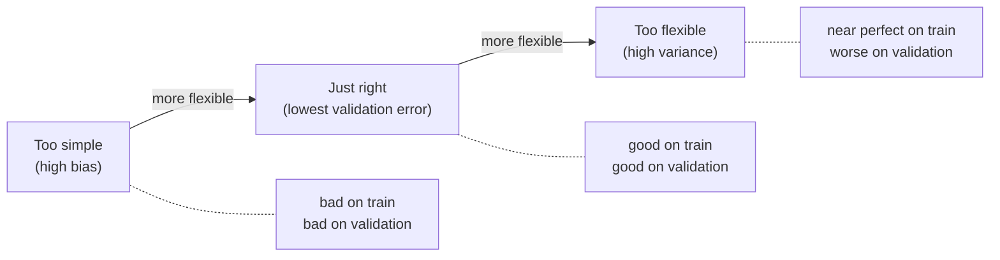

> [!abstract] Today
> Why a model that is perfect on its training data can be useless, and how to measure what it will really do. About 25 minutes: warm-up, lesson, puzzle.

## Warm-up

> [!question]- Why can an endless chain of promise callbacks freeze a page, while an endless chain of `setTimeout` calls does not?
> The [[microtask-queue|microtask queue]] must be completely empty before the browser can paint or take the next task. A [[promise|promise]] chain
> keeps refilling it, so that never happens. Each `setTimeout` callback is a separate task, and the browser can paint
> between tasks. From [[2026-11-11-event-loop|#1 · The event loop]].

> [!question]- You copy a list of lists with `new = old.copy()` and then change `new[0][0]`. Does `old` change?
> Yes. `.copy()` is shallow: the new outer list holds the same inner lists. `copy.deepcopy(old)` copies the inner
> lists too. From [[2026-11-12-python-object-model|#2 · Python's object model]].

## The idea

A model is useful only if it works on data it has **never seen**. Doing well on the data it was trained on proves
almost nothing, because a flexible enough model can simply memorise that data.

That is **[[overfitting|overfitting]]**: the model learns the noise in its training data along with the real pattern, so it looks
great in training and does worse on new data. The opposite failure, underfitting, is a model too simple to capture
the real pattern at all; it is bad everywhere.

So every honest ML workflow has one rule at its centre: **measure the model on data it did not learn from, and never
let that data influence any decision you make while building it.** The [[train-validation-test-split|train, validation and test split]] is how you
follow the rule. [[data-leakage|Data leakage]] is every way of breaking it by accident.

## How it really works

### Where the error comes from

Suppose the true relationship is some function `f(x)`, and every label you collect has random noise on top:
`y = f(x) + noise`. You train a model on one sample of data. Its expected squared error on a new point splits into
three parts (Hastie, Tibshirani and Friedman, *The Elements of Statistical Learning*, section 7.3):

| Part | What it measures | Goes down when |
|---|---|---|
| **Bias²** | How far the model's average prediction is from the truth. A straight line fitted to a curve is wrong in the same way on every sample | The model gets more flexible |
| **Variance** | How much the model changes if you train it on a different sample. A model that memorises points changes a lot | The model gets simpler, or you get more data |
| **Irreducible error** | The noise in the labels themselves | Never: no model can predict noise |

Making a model more flexible lowers bias and raises variance. Somewhere in between is the setting with the lowest
total error. That is the [[bias-variance-trade-off|bias-variance trade-off]], and it is why "use the most powerful model" is not an answer.



### The three splits

You cut your labelled data into three groups before you do anything else:

| Split | Typical share | Used for | Touched how often |
|---|---|---|---|
| **Training set** | 60-80% | Fitting the model's parameters | Every training run |
| **Validation set** | 10-20% | Choosing between models, features and settings (hyperparameters) | Many times |
| **Test set** | 10-20% | One final estimate of performance on new data | Once, at the end |

Why two held-out sets and not one? Because choosing is a form of learning. If you try 50 settings and keep the one
with the best validation score, part of that score is luck that happened to suit the validation set. The test set
was not involved in any choice, so its score is the unbiased one. Look at it repeatedly and adjust, and it becomes a
second validation set that can no longer tell you the truth.

When data is small, a single validation split is noisy. [[cross-validation|Cross-validation]] fixes that: split the training data into k
parts (folds), train k times, each time holding out a different fold, and average the k scores. The test set still
stays outside all of it.

## Example

The true rule below is `sin(x)`, with noise of standard deviation 0.3 added to every label, so even a perfect model
has a mean squared error of about 0.09 on new data. The model is k-nearest neighbours: to predict at `x`, average the
labels of the `k` closest training points. Small `k` is flexible; large `k` is rigid. Predict before you read the
output: which `k` is best on the training set, and which on the validation set?

```py run
import math, random

random.seed(0)

def make_data(n):
    # the true rule is sin(x); every label gets random noise on top
    xs = [random.uniform(0, 6) for _ in range(n)]
    return [(x, math.sin(x) + random.gauss(0, 0.3)) for x in xs]

def predict(train, x, k):
    # k-nearest neighbours: average the labels of the k closest training points
    nearest = sorted(train, key=lambda p: abs(p[0] - x))[:k]
    return sum(y for _, y in nearest) / k

def mse(train, data, k):
    return sum((predict(train, x, k) - y) ** 2 for x, y in data) / len(data)

train, val = make_data(40), make_data(200)
for k in [1, 3, 7, 15, 40]:
    print(f"k={k:2}  train={mse(train, train, k):.3f}  val={mse(train, val, k):.3f}")
# k= 1  train=0.000  val=0.203
# k= 3  train=0.081  val=0.121
# k= 7  train=0.112  val=0.131
# k=15  train=0.133  val=0.136
# k=40  train=0.594  val=0.612
```

Read it row by row:

- **k = 1** has zero training error: each training point's nearest neighbour is itself. It memorised the noise, and
  its validation error is the second worst. High variance.
- **k = 40** averages all 40 training points, so it predicts one flat number everywhere. Bad on both sets. High bias.
- **k = 3** has the lowest validation error, 0.121, not far above the 0.09 floor set by the noise.
- The gap between training and validation error is the signature of overfitting. At k = 1 it is 0.203; at k = 15 it
  is almost zero, but both numbers are worse than at k = 3.

The training error kept falling as the model got more flexible. The validation error fell, then rose. **Never pick a
model by its training error.**

## Traps

Most real failures are not overfitting in the textbook sense. They are data leakage: information from outside the
training data, or from the future, gets into training, so the held-out score is too good. The model then fails in
production, where that information is not there. Kaufman and colleagues, in a 2012 paper, describe it as using
information that would not legitimately be available when the model makes real predictions. Four forms come up again
and again.

**1. Preprocessing on all the data before splitting.** Scaling, filling in missing values, or selecting features
using the full dataset lets the test rows shape the model. The effect can be huge. Below, the labels are coin flips
and every feature is random noise, so no honest model can beat 50%.

```py run
import random

random.seed(1)
n_rows, n_features = 60, 2000
# pure noise: the labels are coin flips and no feature has anything to do with them
X = [[random.gauss(0, 1) for _ in range(n_features)] for _ in range(n_rows)]
y = [random.randint(0, 1) for _ in range(n_rows)]

def top_features(rows, labels, k=10):
    # score each feature by the gap between its mean in class 1 and in class 0
    def gap(j):
        a = [r[j] for r, l in zip(rows, labels) if l == 1]
        b = [r[j] for r, l in zip(rows, labels) if l == 0]
        return abs(sum(a) / len(a) - sum(b) / len(b))
    return sorted(range(len(rows[0])), key=gap, reverse=True)[:k]

def nearest_centroid_accuracy(train, test, feats):
    def centroid(c):
        rows = [r for r, l in train if l == c]
        return [sum(r[j] for r in rows) / len(rows) for j in feats]
    cents = {c: centroid(c) for c in (0, 1)}
    def dist(r, c):
        return sum((r[j] - m) ** 2 for j, m in zip(feats, cents[c]))
    hits = sum(min((0, 1), key=lambda c: dist(r, c)) == l for r, l in test)
    return hits / len(test)

data = list(zip(X, y))
train, test = data[:40], data[40:]

leaky = top_features(X, y)                                            # features chosen using ALL rows
honest = top_features([r for r, _ in train], [l for _, l in train])  # features chosen using train rows only
print("leaky :", nearest_centroid_accuracy(train, test, leaky))   # leaky : 0.85
print("honest:", nearest_centroid_accuracy(train, test, honest))  # honest: 0.4
```

With 2,000 noise features, some happen to line up with the 20 test labels by chance. Choosing features while looking
at those labels finds them, and the test score jumps to 85% on pure noise. The fix: fit every preprocessing step on
the training rows only, then apply it to the others. In scikit-learn, put the steps in a `Pipeline` so
cross-validation refits them inside every fold (see scikit-learn's
[common pitfalls](https://scikit-learn.org/stable/common_pitfalls.html) page).

**2. Features that are only known after the answer.** Predicting whether a customer will cancel, with a column
"days since last support call about cancelling". Predicting a diagnosis with a column for the treatment given. These
are called target leakage: the feature is a consequence of the label. Ask of every column: at the moment the model
makes this prediction in real life, would this value exist yet?

**3. A random split on time-ordered data.** If you shuffle a year of daily sales and split randomly, the model trains
on December and is tested on November. In production it will never see the future. Split by time: train on the past,
validate on what came after (scikit-learn's `TimeSeriesSplit` does this for cross-validation).

**4. The same entity on both sides.** Several X-rays from one patient, several rows per user, near-duplicate
images. If the patient is in both training and test sets, the model can recognise the patient instead of the disease.
Split by group, so all rows of one patient land on one side (`GroupKFold`).

**And the quiet one: tuning on the test set.** Every time you look at the test score and change something, some of
the test set leaks into your choices. Use validation for decisions; use test once.

## In the wild

Kapoor and Narayanan, at Princeton, surveyed published research that used machine learning and found data leakage
behind many results that did not reproduce
([paper in *Patterns*, 2023](https://doi.org/10.1016/j.patter.2023.100804)). Their
[running list](https://reproducible.cs.princeton.edu/) of such errors, checked on 2026-11-13, counts 41 papers from 30
fields that found problems, together affecting 648 papers. In their own case study on civil war prediction, the
prominent studies claiming that complex ML models beat plain logistic regression failed to reproduce once the errors
were fixed. The pitfalls they list are the ones above: preprocessing on training and test data together, illegitimate
features, temporal leakage, and training and test sets that are not independent.

## How interviews ask it

> [!question]- "Your model gets 99% on training data and 70% on test data. What is going on and what do you do?"
> That gap is overfitting: the model fits noise in the training data that does not carry over. First I would rule out
> a split problem, such as test rows that come from a different period or population than the training rows. Then I would reduce
> variance: a simpler model or fewer features, regularisation (L1/L2, dropout, early stopping, shallower trees), or
> more training data. I would compare options with cross-validation on the training data, and only look at the test
> set again at the very end.

> [!question]- "Why do you need a validation set if you already have a test set?"
> Because choosing a model is itself fitting. If I try many settings and keep the one that scores best on a held-out
> set, that score is biased upward: some of it is luck that suits that particular set. The validation set absorbs
> those choices. The test set is used once, after all decisions are made, so its score is an honest estimate of
> performance on new data.

> [!question]- "Your churn model had an AUC of 0.97 offline and is close to random in production. Where do you look?"
> Leakage first. I would look for features that are only known after the outcome, such as status fields updated when
> the customer leaves, and check feature importance for a single column that dominates. I would check that the split
> respected time, that the same customer did not appear in both training and test data, and that scaling or encoding
> was fitted on training rows only. Then I would compare the production feature values with the training ones, since
> a pipeline that computes a feature differently online is another common cause.

## Build it

Take any dataset you have used (a Kaggle CSV is fine). Write a script that splits it 70/15/15 with a fixed random
seed, trains one model at five levels of flexibility (tree depth 1 to 15, or `k` in k-nearest neighbours), and
prints the training and validation scores side by side, like the table above. Pick a setting from validation alone,
then report the test score once. Then deliberately leak: scale or select features on the full dataset first, and
measure how much the validation score improves. Write one sentence on why that improvement is fake.

## Check yourself

> [!question]- A model's training error keeps falling as you make it more flexible. What usually happens to its validation error, and why?
> It falls at first, then rises. More flexibility lowers bias, but past some point the model starts fitting the noise
> in the training data, so its variance grows faster than its bias shrinks. The best setting is where validation
> error is lowest, not training error.

> [!question]- You standardise every column using the mean and standard deviation of the whole dataset, then split. What is wrong?
> The test rows helped compute the mean and standard deviation, so information from the test set entered training.
> Fit the scaler on the training rows only and apply that same fitted scaler to the validation and test rows.

> [!question]- You have three years of sales data and want to predict next month. How should you split it?
> By time, not at random: train on the earliest data, validate on the months after it, and test on the most recent
> months. A random split lets the model learn from the future, which it cannot do in production.

## Puzzle

Today: [[valid-anagram|Valid Anagram]]. Yesterday's [[contains-duplicate|Contains Duplicate]] now has its solution.

## Market word: distributed systems

In 24 of 1,200 Canadian entry-level job posts this week. A distributed system is one program that runs on several
machines that cooperate over a network, such as a database replicated across three servers or a payment service
running on twenty containers. Job posts ask for it because almost every backend at scale is one, and it brings
problems a single machine does not have: messages that arrive late or never, machines that fail halfway through,
and copies of data that disagree. If you have called one service from another over HTTP and had to decide what to do
when it timed out, you have already met the central problem. [[microservices|Microservices]] are one way of building a distributed
system, which is why the two terms show up in the same posts.
