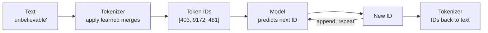

> [!abstract] Today
> A language model never sees letters or words. It sees a list of integers called [[token|tokens]]. About 25 minutes: warm-up, lesson, puzzle.

## Warm-up

> [!question]- Why does `.then` run before `setTimeout(fn, 0)`?
> `.then` callbacks are microtasks, and the [[microtask-queue|microtask queue]] is emptied right after the current task. The timer callback is a separate task that waits for a later turn. From [[2026-11-11-event-loop|#1 · The event loop]].

> [!question]- Why can a Python list not be a dict key?
> Lists are [[mutability|mutable]], so their hash could change after insertion and the key would be lost in the wrong slot. From [[2026-11-12-python-object-model|#2 · Python's object model]].

> [!question]- Your model scores 99% on training data and 70% on test data. What is going on?
> That gap is [[overfitting|overfitting]]: the model fitted noise in the training data. Check the split first, then reduce variance with a simpler model, regularisation or more data. From [[2026-11-13-overfitting|#3 · Overfitting]].

## The idea

A neural network works on numbers, not text. Before a model reads your prompt, a program called a **tokenizer** cuts the text into pieces and maps each piece to an integer. Those pieces are **tokens**. The model reads and writes only token IDs. After it predicts the next ID, the tokenizer turns the IDs back into text.

A token is not a word. It can be a whole common word (`the`), part of a word (`un` + `believ` + `able`), a single character, a space plus a word, or one raw byte. The set of all pieces is the **vocabulary**, usually tens of thousands to a few hundred thousand entries. Each model family has its own vocabulary, so the same text gives different token counts on different models.

Why you care as an engineer:

- **Cost.** APIs bill per token, and input and output tokens often have different prices.
- **Speed.** More input tokens take longer to process. Output tokens are produced one at a time.
- **Limits.** The [[context-window|context window]] is measured in tokens, not characters.
- **Odd failures.** Models that see tokens, not letters, can be unreliable at counting letters or reversing a word.

## How it really works



The IDs in the diagram are made up. Real IDs depend on the vocabulary.

### Where the vocabulary comes from

Most current tokenizers use **[[byte-pair-encoding|byte-pair encoding]]** (BPE) or a close relative. Sennrich, Haddow and Birch (2016) brought it to neural translation as a way to handle rare words: break them into known subword pieces instead of mapping them to an "unknown" symbol. Training a BPE vocabulary goes like this:

1. Start with every character (or every byte) as its own piece.
2. Count how often each adjacent pair of pieces occurs in a large body of text.
3. Merge the most frequent pair into one new piece. Record the merge.
4. Repeat until the vocabulary has the size you want.

To tokenize new text later, start from single characters and replay the recorded merges in order. Frequent words end up as one token. Rare words fall apart into smaller known pieces. Text never seen before still works, because the single characters (or bytes) are always in the vocabulary.

Other methods exist (WordPiece, Unigram as in SentencePiece by Kudo and Richardson, 2018), but the idea is the same: a fixed vocabulary of subword pieces learned from data.

### Bytes, not characters

Many modern tokenizers work on the UTF-8 bytes of the text, so any string can be encoded and nothing is "unknown". That has a cost: characters outside plain English take several bytes, and each extra byte can mean extra tokens. Text in some languages, emoji and unusual symbols often use more tokens per character than English prose.

### The context window

The model can only attend to a limited number of tokens at once: the context window. It holds your prompt, any documents you add, the conversation so far and the reply being written. In the transformer design (Vaswani et al., 2017) every token attends to every earlier token, so the work grows quickly with length. That is one reason long inputs cost more time and money.

## Example

Here is a tiny BPE trainer in plain Python. It learns merges from a small corpus, then tokenizes words it has and has not seen. Predict what `lowest` becomes before you read the output.

```py run
from collections import Counter

def pair_counts(words):
    counts = Counter()
    for word, freq in words.items():
        for a, b in zip(word, word[1:]):
            counts[(a, b)] += freq
    return counts

def merge(word, pair):
    out, i = [], 0
    while i < len(word):
        if i < len(word) - 1 and (word[i], word[i + 1]) == pair:
            out.append(word[i] + word[i + 1])
            i += 2
        else:
            out.append(word[i])
            i += 1
    return tuple(out)

def train_bpe(text, num_merges):
    words = Counter(tuple(w) for w in text.split())
    merges = []
    for _ in range(num_merges):
        counts = pair_counts(words)
        if not counts:
            break
        best = max(counts, key=lambda p: (counts[p], p))   # ties: larger pair wins
        merges.append(best)
        words = Counter({merge(w, best): f for w, f in words.items()})
    return merges

def encode(word, merges):
    pieces = tuple(word)
    for pair in merges:          # replay the merges in the order they were learned
        pieces = merge(pieces, pair)
    return list(pieces)

corpus = ("low low low low low lower lower newest newest newest "
          "newest newest newest widest widest widest")
merges = train_bpe(corpus, 8)
for i, m in enumerate(merges, 1):
    print(i, m)
# 1 ('s', 't')
# 2 ('e', 'st')
# 3 ('o', 'w')
# 4 ('l', 'ow')
# 5 ('w', 'est')
# 6 ('n', 'e')
# 7 ('ne', 'west')
# 8 ('w', 'i')

for w in ["lowest", "newer", "wider", "xyz"]:
    print(w, encode(w, merges))
# lowest ['low', 'est']
# newer ['ne', 'w', 'e', 'r']
# wider ['wi', 'd', 'e', 'r']
# xyz ['x', 'y', 'z']
```

Read it:

- `lowest` never appeared in the corpus, yet it becomes two familiar pieces, `low` and `est`. That is the point of subwords.
- `newer` is split into four pieces, because the corpus only had `newest`. Text that looks unlike the training data costs more tokens.
- `xyz` falls back to single characters. Nothing is ever "unknown".

Now bytes. The same visible length can mean very different byte counts:

```py run
for s in ["hello", "héllo", "你好", "😀"]:
    print(repr(s), len(s), len(s.encode("utf-8")))
# 'hello' 5 5
# 'héllo' 5 6
# '你好' 2 6
# '😀' 1 4
```

One emoji is four bytes. A byte-level tokenizer may need several tokens for it unless the vocabulary has learned it as a piece. You cannot get the token count from `len(text)`. Use the provider's counting tool for the model you call.

### Cost grows faster than you think

A chat API is stateless: every turn you send the whole history again. The prices below are invented to show the shape of the cost.

```py run
PRICE_IN, PRICE_OUT = 3.00, 15.00   # made-up dollars per million tokens

def cost(tokens_in, tokens_out):
    return tokens_in / 1e6 * PRICE_IN + tokens_out / 1e6 * PRICE_OUT

history, total_in, total_out = 500, 0, 0     # a 500-token system prompt
for turn in range(1, 11):
    user, reply = 100, 300
    total_in += history + user               # the whole history is sent again
    total_out += reply
    history += user + reply
print(total_in, total_out)                   # 24000 3000
print(round(cost(total_in, total_out), 4))   # 0.117
print(round(cost(600, 300), 4))              # 0.0063  (just turn 1)
```

Ten turns produced 3,000 output tokens but sent 24,000 input tokens. Input grows with the square of the number of turns, because each turn re-reads everything before it. Providers offer prompt caching to cut the price of a repeated prefix, but the shape is why long chats get expensive.

## Traps

- **Counting characters or words.** English averages roughly four characters per token, but that is a rule of thumb for English prose only. Code, numbers, other languages and emoji differ.
- **Using another model's tokenizer.** Vocabularies differ between model families. A count from one is only an estimate for another.
- **Forgetting the reply.** Input plus output must fit in the window. Many APIs also cap the output length separately.
- **Leading spaces and case.** `hello`, ` hello` and `Hello` are usually different tokens. Stray whitespace in a prompt changes the count and can change behaviour slightly.
- **Letter-level tasks.** "How many r's in strawberry?" asks about characters, but the model sees a few chunks. Do exact string work in code.
- **Numbers.** Long numbers are split into chunks in tokenizer-specific ways, which is one reason arithmetic on long numbers is unreliable.

## How interviews ask it

> [!question]- "What is a token, and why not just use words or characters?"
> A token is a piece of text from a fixed vocabulary, mapped to an integer. Words alone need an enormous vocabulary and fail on rare words, names and typos. Characters never fail but make sequences very long, and cost grows with length. Subword tokens sit between: common words are one token, rare ones split into known pieces, so the vocabulary stays manageable and nothing is unknown.

> [!question]- "A user complains that your summariser errors on long documents. How do you debug it?"
> I would count tokens, not characters, with the tokenizer for the exact model. Prompt plus expected output has to fit the context window. If it does not fit, I would split the document into chunks, summarise each, and summarise the summaries. I would also check the output limit and whether the error is a length error or a quality problem on long inputs.

> [!question]- "How would you reduce the cost of an LLM feature?"
> Cut input tokens first: shorter system prompt, trim or summarise old chat history, retrieve only relevant chunks instead of whole documents. Cache a repeated prefix if the provider supports it. Use a smaller model where quality allows. Cap output length. Measure tokens per request in logs so the effect is visible.

## Build it

Write a function `count_tokens(text)` that calls your provider's token-counting endpoint (the Anthropic docs describe one) for a given model. Run it over five strings: plain English, a code snippet, a sentence in another language, a long number and a few emoji. Print characters, bytes and tokens in a table. Write two sentences on which ratio surprised you.

## Check yourself

> [!question]- Why does a BPE tokenizer never meet an "unknown word"?
> It can always fall back to smaller pieces, down to single characters or bytes, which are all in the vocabulary. A new word is split into known pieces.

> [!question]- Why does a ten-turn chat cost much more than ten separate one-turn requests of the same size?
> Each turn resends the whole history as input, so input tokens add up like 1 + 2 + 3 + ... turns' worth. Cost grows roughly with the square of the number of turns.

> [!question]- You measured a prompt as 4,000 tokens on one model family. Is it 4,000 on another?
> Not necessarily. Each family has its own vocabulary, so counts differ. Use the target model's own counter.

## Puzzle

Today: [[group-anagrams|Group Anagrams]]. Yesterday's [[valid-anagram|Valid Anagram]] has its solution.

## Market word: unit testing

In 21 of 1,200 Canadian entry-level job posts in the last gap report (week to 2026-11-09). A [[unit-testing|unit test]] runs one small piece of code, usually a function, with known input and checks the output. Job posts ask for it because tests let a team change code without fear, and they run on every push in the build pipeline. It connects to today: if you build on an LLM, wrap the model call behind a function and unit test everything around it, such as prompt building and token counting, with fixed inputs. The model call itself is slow and not exactly repeatable, so you replace it with a stub in tests.
