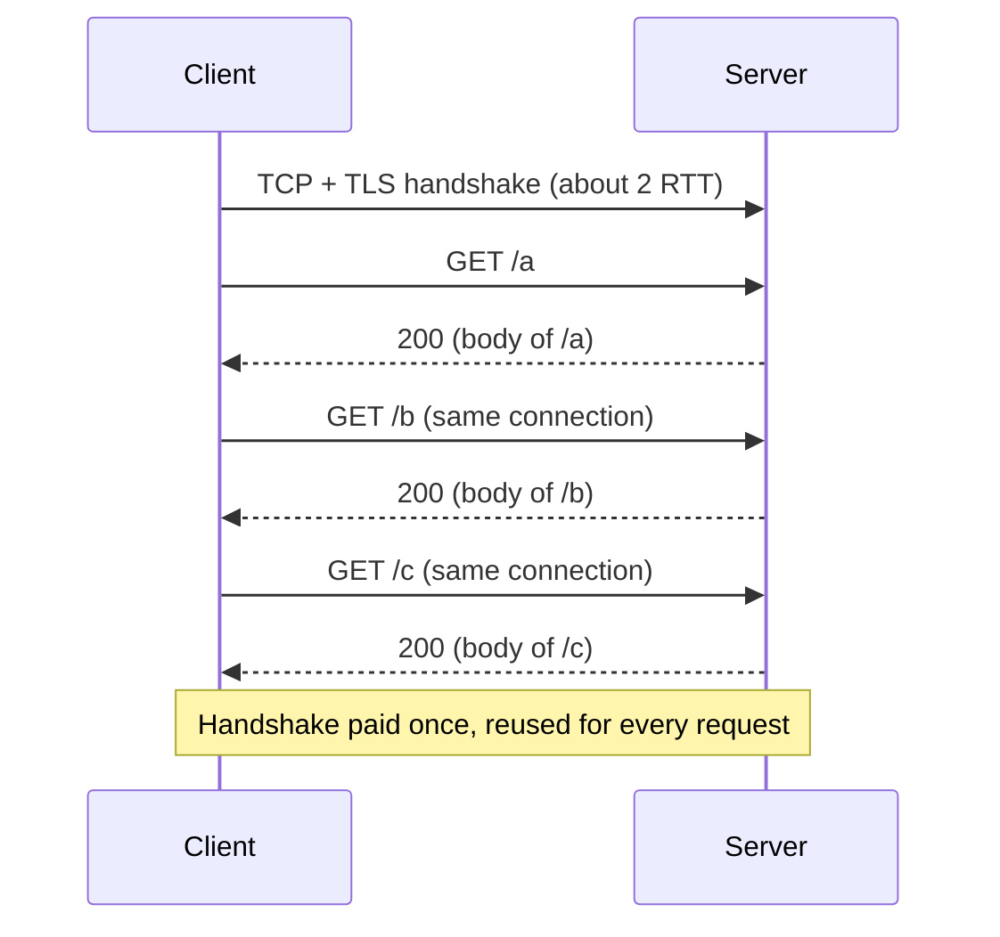

<!-- read-first -->
> [!info] Read first
> [[http|HTTP]] · [[idempotency|Idempotency]]
<!-- /read-first -->

> [!abstract] Today
> [[http|HTTP]] is a plain-text conversation: one request, one response. Learn the parts, the rules that make retries safe, and why one connection can serve many requests. About 25 minutes: warm-up, lesson, puzzle.

## Warm-up

> [!question]- Overfitting: training error keeps falling as a model gets more flexible. What happens to validation error?
> It falls at first, then rises. More flexibility lowers bias, but past some point the model fits noise and its variance grows faster than its bias shrinks. Pick the setting where validation error is lowest. From [[2026-11-13-overfitting|#3 · Overfitting]].

> [!question]- After a script finishes, which runs first: a `setTimeout(fn, 0)` callback or a `.then` callback?
> The `.then` callback. It is a microtask, and the [[microtask-queue|microtask queue]] is emptied as soon as the current task ends, before the loop takes the next task where the timer waits. From [[2026-11-11-event-loop|#1 · The event loop]].

> [!question]- Why does `def f(x, items=[])` keep items from earlier calls?
> Default values are evaluated once, when the `def` line runs, so every call shares one list. Use `items=None` and build a new list inside. From [[2026-11-12-python-object-model|#2 · Python's object model]].

## The idea

**HTTP** (HyperText Transfer Protocol) is how a client, such as a browser or your code, asks a server for something and gets an answer. It is **request and response**: the client speaks first, the server replies once, and the exchange is over. The server does not remember the client between exchanges. That property is called **stateless**, and it is why servers can be copied behind a load balancer and why things like cookies and [[token|tokens]] exist.

Every HTTP message has the same shape: a first line, some headers, a blank line, and an optional body. In HTTP/1.1 it is literally text. The meaning of the messages (methods, status codes, headers) is defined in RFC 9110 and is shared by every HTTP version. Only the way the bytes are laid out on the wire changes between versions.

## How it really works

### The anatomy of a request and a response

```text
GET /items/9 HTTP/1.1          <- request line: method, target, version
Host: example.com              <- headers: name: value
Accept: application/json
                               <- blank line ends the headers
                               <- (a GET usually has no body)

HTTP/1.1 404 Not Found         <- status line: version, code, reason
Content-Type: application/json
Content-Length: 22

{"error": "not found"}         <- body
```

- The **method** says what the client wants to do. The **target** says to what.
- **Headers** carry metadata: `Host` (required in HTTP/1.1, so one server can host many sites), `Content-Type` (what the body is), `Content-Length` (how many bytes), `Authorization`, `Cache-Control`, `Location` and more.
- The **status code** tells the client what happened, in a form code can branch on.

### Methods: safe and idempotent

Two properties, both defined in RFC 9110, decide what a client may do automatically.

- A method is **safe** if it is meant only to read. The client does not ask for a change.
- A method is [[idempotency|idempotent]] if sending the same request many times leaves the server in the same state as sending it once.

| Method | Meaning | Safe | Idempotent |
|---|---|:-:|:-:|
| GET | Read a resource | yes | yes |
| HEAD | Like GET, headers only | yes | yes |
| OPTIONS | Ask what is allowed | yes | yes |
| PUT | Replace the resource at this URL | no | yes |
| DELETE | Remove the resource | no | yes |
| POST | Process this body (create, trigger, anything) | no | **no** |
| PATCH | Apply a partial change | no | **no** (not guaranteed) |

Idempotent describes the effect on the server, not the response. The first `DELETE` returns `204`, the second `404`, and the server state is the same: the item is gone.

Why it matters: networks fail. If you send a request and the connection drops, you do not know whether the server processed it. For an idempotent method you can simply send it again. For `POST` you cannot, because a retry might create a second order or charge a card twice. The fix for payments and similar is an **idempotency key**: the client sends a unique ID in a header, and the server remembers it and returns the earlier result if it sees the same ID again. (Lesson 11 covers this.)

### Status codes that matter

The first digit is the class. Learn the classes, then the dozen codes you will meet daily. The full list is in [[http-status-codes|HTTP status codes]].

| Class | Meaning | Codes to know |
|---|---|---|
| 2xx | Success | 200 OK, 201 Created (with a `Location` header), 204 No Content |
| 3xx | Look elsewhere | 301 and 308 (moved for good), 302 and 307 (moved for now), 304 Not Modified |
| 4xx | The client got it wrong | 400, 401 (not authenticated), 403 (not allowed), 404, 409 (conflict), 422, 429 (slow down) |
| 5xx | The server got it wrong | 500, 502 (bad upstream reply), 503 (unavailable), 504 (upstream timeout) |

Two pairs are often confused. **401** means "I do not know who you are": log in. **403** means "I know who you are and the answer is no". And `301`/`302` may turn a `POST` into a `GET` when followed, while `308`/`307` keep the method.

The class tells a client whether to retry: 4xx usually means the same request will fail again, so fix it. 502, 503 and 504, and 429 with a `Retry-After` header, are the ones worth retrying after a wait.

### Caching in one paragraph

A `GET` response can carry `Cache-Control: max-age=3600` (reuse for an hour) and an `ETag` (a fingerprint of the content). Later the client asks "give me this only if it changed" with `If-None-Match: <etag>`. If nothing changed, the server answers `304 Not Modified` with no body, and the client reuses its copy. Lesson 17 goes deeper; the rules are in RFC 9111.

### Connections: where the time goes

HTTP runs on top of [[tcp|TCP]], and usually [[tls|TLS]] (that is HTTPS). Opening a connection costs round trips before any request is sent. With one round trip taking `RTT` milliseconds:

- TCP handshake: 1 RTT.
- TLS 1.3 handshake: 1 more RTT.
- The request and its response: 1 RTT.

So a request on a brand new HTTPS connection costs about 3 RTT, and one on an open connection costs 1.

**Keep-alive** (a *persistent connection*) is the fix. In HTTP/1.0 the server closed the connection after each response. HTTP/1.1 keeps it open by default, and the client reuses it for the next request. The server must tell the client where each response ends, which is why `Content-Length` (or chunked transfer encoding) is required. A `Connection: close` header opts out.



### HTTP/1.1, HTTP/2 and HTTP/3

On one HTTP/1.1 connection, responses come back **in order**. If the first response is slow, the ones behind it wait. This is **head-of-line blocking**. Browsers work around it by opening several connections (commonly six) per host.

**HTTP/2** (RFC 9113) keeps the same methods, headers and status codes but changes the wire format:

- The text becomes binary **frames**, grouped into numbered **streams**. Many requests share **one** connection at the same time (multiplexing), and responses can interleave.
- Headers are compressed (HPACK), which helps because headers repeat on every request.
- One connection per host is enough, so the handshake cost is paid once.

HTTP/2 still sits on TCP, and TCP delivers bytes in order. If one packet is lost, every stream on that connection waits for the resend. So head-of-line blocking moved down a layer. **HTTP/3** (RFC 9114) runs on QUIC over UDP, where streams are independent, so a lost packet delays only its own stream.

| | HTTP/1.1 | HTTP/2 | HTTP/3 |
|---|---|---|---|
| Format | Text | Binary frames | Binary frames |
| Requests in parallel on one connection | No (in order) | Yes (streams) | Yes (streams) |
| Header compression | No | HPACK | QPACK |
| Transport | TCP | TCP | QUIC (over UDP) |

Your application code usually does not change between versions. The server, proxy or CDN negotiates the version.

## Example

Run a tiny server from the Python standard library and talk to it. Predict the printed lists before you read on.

```py run
import json, socket, threading
from http.client import HTTPConnection
from http.server import BaseHTTPRequestHandler, ThreadingHTTPServer

items, stats = {}, {"connections": 0, "requests": 0, "next_id": 1}

class Handler(BaseHTTPRequestHandler):
    protocol_version = "HTTP/1.1"          # keep-alive needs 1.1 and a Content-Length

    def setup(self):
        super().setup()
        stats["connections"] += 1          # runs once per TCP connection

    def log_message(self, *args):          # silence the access log
        pass

    def reply(self, status, body=None, headers=None):
        data = json.dumps(body).encode() if body is not None else b""
        self.send_response(status)
        self.send_header("Content-Type", "application/json")
        self.send_header("Content-Length", str(len(data)))
        for k, v in (headers or {}).items():
            self.send_header(k, v)
        self.end_headers()
        self.wfile.write(data)

    def read_json(self):
        n = int(self.headers.get("Content-Length", 0))
        return json.loads(self.rfile.read(n)) if n else None

    def do_GET(self):
        stats["requests"] += 1
        item = items.get(self.path)
        if item is not None:
            self.reply(200, item)
        else:
            self.reply(404, {"error": "not found"})

    def do_POST(self):                     # create: the server picks the URL
        stats["requests"] += 1
        path = f"/items/{stats['next_id']}"
        stats["next_id"] += 1
        items[path] = self.read_json()
        self.reply(201, items[path], {"Location": path})

    def do_PUT(self):                      # replace at a URL the client chose
        stats["requests"] += 1
        existed = self.path in items
        items[self.path] = self.read_json()
        self.reply(200 if existed else 201, items[self.path])

    def do_DELETE(self):
        stats["requests"] += 1
        found = items.pop(self.path, None) is not None
        self.reply(204 if found else 404)

server = ThreadingHTTPServer(("127.0.0.1", 0), Handler)   # port 0: any free port
port = server.server_address[1]
threading.Thread(target=server.serve_forever, daemon=True).start()

# 1. The raw text on the wire
sock = socket.create_connection(("127.0.0.1", port))
sock.sendall(b"GET /items/9 HTTP/1.1\r\nHost: localhost\r\nConnection: close\r\n\r\n")
raw = b""
while chunk := sock.recv(4096):
    raw += chunk
sock.close()
head, body = raw.decode().split("\r\n\r\n")
print(head.splitlines()[0])   # HTTP/1.1 404 Not Found
print(body)                   # {"error": "not found"}

# 2. Idempotency, sent over a single reused connection
conn = HTTPConnection("127.0.0.1", port)

def call(method, path, body=None):
    payload = json.dumps(body) if body is not None else None
    conn.request(method, path, payload, {"Content-Type": "application/json"})
    r = conn.getresponse()
    r.read()
    return r.status

print([call("POST", "/items", {"n": 1}) for _ in range(2)])    # [201, 201]
print(len(items))                                              # 2  (two items: not idempotent)
print([call("PUT", "/items/50", {"n": 1}) for _ in range(3)])  # [201, 200, 200]
print(len(items))                                              # 3  (one item, however often we PUT)
print([call("DELETE", "/items/50") for _ in range(2)])         # [204, 404]
print(stats["requests"], stats["connections"])                 # 8 2
server.shutdown()
```

Read it:

- Part 1 is a real HTTP/1.1 exchange written by hand. There is no magic in the protocol: you send text and read text.
- `POST` twice made two items. `PUT` three times made one. That is the whole difference between non-idempotent and idempotent. Note that the `PUT` *status codes* differed (`201` then `200`) while the *state* did not.
- Eight requests used only two connections: the raw socket and the one `HTTPConnection` that was reused for the other seven. That is keep-alive.

Now put numbers on the connection cost. Assume 50 ms round trips and 10 requests to the same host:

```py run
RTT = 50                       # milliseconds per round trip
requests = 10

def cost_new_connection_each_time():
    return requests * (1 + 1 + 1) * RTT      # TCP + TLS 1.3 + request, every time

def cost_keep_alive():
    return (1 + 1) * RTT + requests * 1 * RTT   # handshakes once, then one RTT per request

print(cost_new_connection_each_time())   # 1500
print(cost_keep_alive())                 # 600
```

This is a simplified model (it ignores transfer time and TCP slow start), but it shows why reusing connections matters more than almost any code tweak.

Last, a retry helper that uses what we learned. It retries only when it is safe and only for errors worth retrying:

```py run
import time

IDEMPOTENT = {"GET", "HEAD", "OPTIONS", "PUT", "DELETE"}
RETRYABLE = {429, 502, 503, 504}

def request_with_retry(send, method, attempts=4, base=0.01):
    for attempt in range(attempts):
        status = send()
        if status not in RETRYABLE or method not in IDEMPOTENT:
            return status
        time.sleep(base * 2 ** attempt)      # exponential backoff: 0.01, 0.02, 0.04 ...
    return status

def flaky(codes):
    codes = iter(codes)
    return lambda: next(codes)

print(request_with_retry(flaky([503, 503, 200]), "GET"))    # 200  (retried twice)
print(request_with_retry(flaky([503, 200]), "POST"))        # 503  (POST is not retried)
print(request_with_retry(flaky([404, 200]), "GET"))         # 404  (a 4xx will not fix itself)
```

A real client would add a random jitter to the wait and honour `Retry-After`. Without a delay, many clients retrying together can overload a server that is already struggling.

## Traps

- **Using GET to change things.** Crawlers, link previewers and browsers prefetch GET URLs. A "delete" link that is a GET will eventually be clicked by a robot.
- **Retrying POST blindly.** A timeout does not mean failure. Use an idempotency key, or make the operation idempotent.
- **Returning 200 with an error in the body.** Clients, proxies and monitoring read the status code. Use the right one.
- **Mixing up 401 and 403.** 401 is about identity, 403 is about permission.
- **Forgetting `Content-Length`** on a keep-alive connection. The client cannot tell where the response ends, so it hangs or the server has to close the connection.
- **"HTTP/2 is always faster".** It helps with many small requests. On a lossy network the shared TCP connection can be slower than several separate ones.
- **Treating the reason phrase as data.** `404 Not Found` and `404 Nope` are the same response. Only the number counts (and HTTP/2 drops the phrase entirely).

## How interviews ask it

> [!question]- "What is the difference between PUT and POST?"
> `PUT` replaces the resource at a URL the client names, and it is idempotent: sending it twice leaves the same state. `POST` hands the server a body to process, usually to create something at a URL the server picks, and it is not idempotent: sending it twice can create two things. So I can retry a `PUT` after a timeout, but a `POST` needs an idempotency key first.

> [!question]- "A payment request timed out. What should the client do?"
> It does not know whether the payment happened, so it must not just send the request again. The client should send the same idempotency key on every attempt. The server stores the key with the result and returns the stored result for a repeat, so the card is charged once. I would also let the client look up the payment by that key to see its final state.

> [!question]- "What does HTTP/2 fix over HTTP/1.1, and what does it not fix?"
> It multiplexes many requests as independent streams over one connection, so a slow response no longer blocks the ones behind it, and it compresses headers. It still runs on TCP, so one lost packet stalls every stream until it is resent. HTTP/3 moves to QUIC over UDP so that a loss only delays its own stream.

## Build it

Extend the server from the example. Add `GET /items/<id>` support for `ETag` and `If-None-Match`: compute the ETag as a hash of the JSON body, return it in a header, and return `304` with an empty body when the client's `If-None-Match` matches. Add a test that makes two requests and checks that the second returns `304`. Then add a `Retry-After: 1` header to a `429` response when a client sends more than five requests in a second, and make the retry helper above wait for that header.

## Check yourself

> [!question]- Why is `DELETE` idempotent even though the second call returns a different status code?
> Idempotency is about server state, not the response. After the first `DELETE` the item is gone; after the second it is still gone. The response differs (`204` then `404`), but the state is the same.

> [!question]- Your client gets `403` on an API call. Should it retry after a few seconds? What about `503`?
> No for `403`: the server understood the request and refused it, so retrying the same request gives the same answer. Yes for `503` (with backoff, and respecting `Retry-After`), because it means the server is temporarily unable to handle the request, and the method must be idempotent.

> [!question]- Ten requests go to one HTTPS host with a 50 ms round trip. Roughly how much does keep-alive save compared with a new connection per request?
> With a new TCP and TLS 1.3 connection each time, each request costs about 3 round trips (150 ms), so 1,500 ms in all. With keep-alive the two handshake round trips are paid once and each request costs one, so about 600 ms. It saves roughly 900 ms in this model.

## Puzzle

Today: [[top-k-frequent-elements|Top K Frequent Elements]]. Yesterday's [[group-anagrams|Group Anagrams]] has its solution.

## Market word: Jenkins

In 20 of 1,200 Canadian entry-level job posts in the last gap report (week to 2026-11-09). Jenkins is an open-source automation server. You point it at a repository, and on every push it checks out the code, builds it, runs the tests and can deploy the result. That practice is called [[continuous-integration|continuous integration]], and Jenkins is one of the oldest tools for it (others are GitHub Actions and GitLab CI). Job posts ask for it because many banks and large companies run their build pipelines on Jenkins, usually described in a file called a `Jenkinsfile`. It connects to today: the last stage of a pipeline often calls an HTTP endpoint, such as a health check that must return `200` before traffic is switched to the new version.
