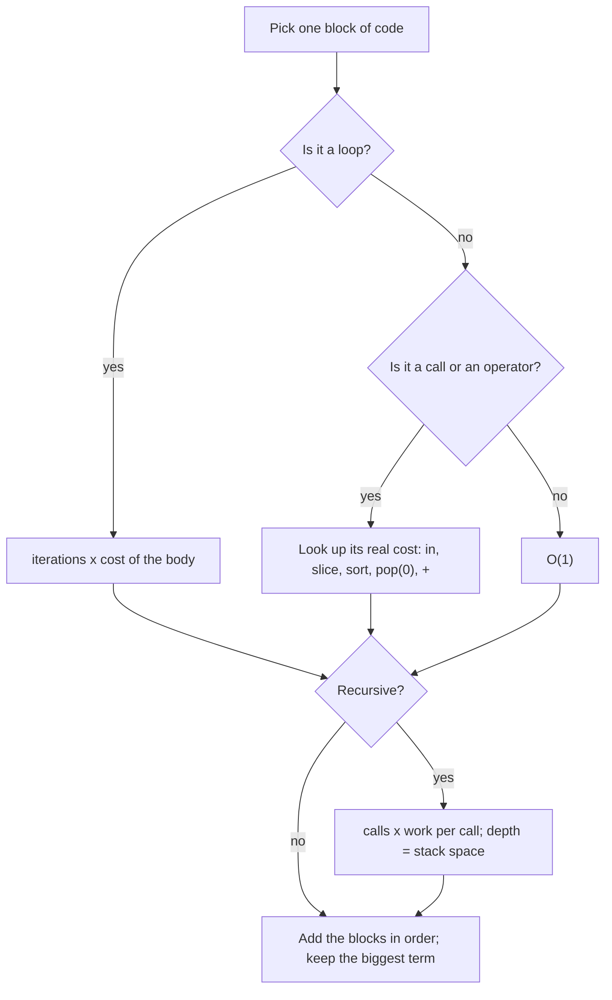

<!-- read-first -->
> [!info] Read first
> [[big-o-notation|Big-O notation]]
<!-- /read-first -->

> [!abstract] Today
> Big-O beyond the table of classes: how to read the cost of your own code, including the costs hidden inside one-line built-ins, why `append` is O(1) "amortized", and what recursion costs in memory. About 25 minutes: warm-up, lesson, puzzle.

## Warm-up

> [!question]- A chat app resends the whole history on every turn. Why does a ten-turn chat cost much more than ten one-turn requests?
> Each turn sends every earlier turn again, so input grows like 1 + 2 + 3 + ... + 10 turns' worth. The total grows with the square of the number of turns. (Keep that sum in mind: it comes back today.) From [[2026-11-17-tokens|#4 · Tokens]].

> [!question]- Why can an endless chain of promise callbacks freeze a page, while an endless chain of `setTimeout` calls does not?
> The [[microtask-queue|microtask queue]] must be empty before the browser can paint or take the next task, and a [[promise|promise]] chain keeps refilling it. Each `setTimeout` callback is a separate task, so the browser gets a turn between them. From [[2026-11-11-event-loop|#1 · The event loop]].

> [!question]- You copy a list of lists with `new = old.copy()` and change `new[0][0]`. Does `old` change?
> Yes. `.copy()` is shallow: the outer list is new, but it holds the same inner lists. Note what it cost, too: a [[shallow-vs-deep-copy|shallow copy]] of n items is O(n), because every reference is copied. From [[2026-11-12-python-object-model|#2 · Python's object model]].

## The idea

You know the table: O(1), O(log n), O(n), O(n log n), O(n²). The table is the easy part. The hard part, and what interviews actually test, is looking at **your own code** and getting the right answer, when the costly work is hidden inside a method call, a slice, a membership test or a recursive call.

Three ideas carry most of the weight:

1. **A line of code is not a step.** `x in items`, `items[1:]`, `sorted(items)` and `items.pop(0)` are each one line and each O(n) or worse. Count the work a line does, not the lines.
2. **Some costs are averaged.** An operation can be slow once in a while and still cost O(1) per call on average across any long run of calls. That is **amortized** cost, and it is why `list.append` is O(1).
3. **Memory has a complexity too.** Every extra list, dict or copy counts, and so does every frame on the call stack while recursion is in progress.

Big-O itself stays the same idea: how cost grows as n grows, with constants and smaller terms dropped. See [[big-o-notation|Big-O notation]] for the classes.

## How it really works

### Reading code: add, multiply, look inside

The rules for combining pieces are short:

- **Steps one after another add**, and the biggest term wins. An O(n) loop followed by an O(n log n) sort is O(n log n).
- **Nested work multiplies.** A loop of n iterations whose body costs O(n) is O(n²), whether the inner cost is a written loop or a hidden one.
- **Recursion is (number of calls) × (work per call).** Count the calls as a tree.
- **Different inputs get different letters.** Comparing every item of a list of size n with every item of a list of size m is O(n · m), not O(n²).



### Hidden costs in Python built-ins

These are the ones that cause real slowdowns. Costs are for CPython; the Python wiki keeps a full table.

| Code | Cost | Why |
|---|---|---|
| `x in some_list` | O(n) | Checks items one by one |
| `x in some_set`, `d[key]` | O(1) average | A [[hash-map\|hash table]] jumps to the slot |
| `items[a:b]`, `items.copy()`, `list(items)` | O(b - a), O(n) | A slice is a new list; every reference is copied |
| `items.pop()`, `items.append(x)` | O(1) (append amortized) | Works at the end |
| `items.pop(0)`, `items.insert(0, x)` | O(n) | Every other item shifts one place |
| `deque.popleft()`, `deque.appendleft(x)` | O(1) | A deque is built for both ends |
| `sorted(items)`, `items.sort()` | O(n log n) | Comparison sort |
| `min(items)`, `sum(items)`, `items.count(x)` | O(n) | One full pass each |
| `a + b` for lists or strings | O(len(a) + len(b)) | Builds a brand new object |
| `len(items)` | O(1) | The length is stored |

The pattern behind the table: anything that **creates a new collection** or **searches without an index** is O(size). Anything that touches one known position is O(1).

The worst offenders are the ones inside a loop. `if x not in seen_list` inside a `for` loop is O(n²). The fix is nearly always a set or dict.

### Amortized cost: why `append` is O(1)

A Python list is a [[dynamic-array|dynamic array]]: a block of memory with room for some number of items, its **capacity**. When you append and there is room, the item goes in the next free slot: O(1). When the block is full, the list asks for a bigger block and copies every item across: O(n) for that one append.

So some appends cost n. Why is append still called O(1)? Because the list grows by a **factor**, not by a fixed amount. Suppose capacity doubles each time it fills. Appending n items copies 1 + 2 + 4 + ... + n/2 items over the whole run, and that sum is less than n. Add the n ordinary writes, and n appends do fewer than 2n units of work: on average, under 2 per append. That average over a whole sequence of operations is the **amortized** cost, and it is a guarantee, not a hope: no sequence of appends can do worse. [[amortized-analysis|Amortized analysis]] covers the reasoning in more detail.

If the list instead grew by one slot each time, every append would copy everything: 1 + 2 + 3 + ... + n, which is about n²/2. That is the same sum as the warm-up's chat history, and it is O(n²).

CPython does not double. It grows by roughly 1/8 plus a little (the formula is in `Objects/listobject.c`), which wastes less memory but still grows by a factor, so the result is the same: amortized O(1). The `dict` and `set` types resize the same way.

Amortized is not the same as "average case". Average case is about typical **inputs** (a hash table with few collisions). Amortized is about a **sequence of operations** on any input. A single append can still take O(n), which matters if you need every operation to be fast, such as in a game loop or a latency-critical server.

### Space complexity: count what you keep

Space complexity counts the **extra** memory an algorithm uses as n grows. Interviewers usually mean extra space and do not count the input, nor the output when the problem asks you to build one. Say which you mean.

- A set of every item seen: O(n).
- A fixed number of variables: O(1).
- A 2D table of n × m: O(n · m).

Recursion uses memory without any visible data structure. Each call that has not returned keeps a frame on the [[call-stack|call stack]] with its local variables. A recursion that goes n levels deep uses O(n) stack space even if it creates nothing else. CPython also caps depth: the default limit is 1,000 frames (`sys.getrecursionlimit()`), and going past it raises `RecursionError`. So a recursive sum over 5,000 items fails in Python even though a loop handles millions.

Slices make it worse. Each `xs[1:]` copies the rest of the list, and all those copies are alive at the same time, one per frame waiting on the stack. Step through it to see the frames pile up: [step through it on Python Tutor](https://pythontutor.com/visualize.html#code=def%20total%28xs%29%3A%0A%20%20%20%20if%20not%20xs%3A%0A%20%20%20%20%20%20%20%20return%200%0A%20%20%20%20return%20xs%5B0%5D%20%2B%20total%28xs%5B1%3A%5D%29%0A%0Aprint%28total%28%5B5%2C%201%2C%204%2C%202%5D%29%29&mode=display&py=3).

## Example

First, read the code and predict, then measure. Two ways to remove duplicates while keeping order. Before you run it: if n doubles, by how much does each one's time grow?

```py run
import timeit

def dedupe_list(items):          # O(n^2): "not in" scans the output list each time
    out = []
    for x in items:
        if x not in out:
            out.append(x)
    return out

def dedupe_set(items):           # O(n): set lookups are O(1) on average
    seen, out = set(), []
    for x in items:
        if x not in seen:
            seen.add(x)
            out.append(x)
    return out

def growth(f, n):
    """Time for 2n divided by time for n. About 2 means O(n); about 4 means O(n^2)."""
    t = lambda size: min(timeit.repeat(lambda: f(list(range(size))), number=1, repeat=5))
    return round(t(2 * n) / t(n), 1)

print(dedupe_list([3, 1, 3, 2, 1]), dedupe_set([3, 1, 3, 2, 1]))   # [3, 1, 2] [3, 1, 2]
print(growth(dedupe_list, 2000))     # about 4 (3.6 to 4.0 on one laptop)
print(growth(dedupe_set, 20000))     # about 2
```

This **doubling test** is the most useful habit in this lesson. You do not need to know the exact time. Double n and look at the ratio: about 2 for O(n), about 4 for O(n²), a bit over 2 for O(n log n), about 8 for O(n³). Use `min` over several runs, because the minimum is the run least disturbed by other work on the machine.

Second, see amortized growth by building a dynamic array that doubles, and counting the copies:

```py run
class DynamicArray:
    def __init__(self):
        self.capacity, self.size, self.copies = 1, 0, 0
        self.slots = [None]

    def append(self, x):
        if self.size == self.capacity:           # full: get a block twice as big
            self.capacity *= 2
            bigger = [None] * self.capacity
            for i in range(self.size):           # the O(n) step
                bigger[i] = self.slots[i]
                self.copies += 1
            self.slots = bigger
        self.slots[self.size] = x                # the O(1) step
        self.size += 1

for n in [1_000, 1_000_000]:
    a = DynamicArray()
    for i in range(n):
        a.append(i)
    print(n, a.copies, round(a.copies / n, 2))
# 1000 1023 1.02
# 1000000 1048575 1.05     -> about one copy per append, however large n gets

import sys
lst, sizes = [], set()
for i in range(1_000_000):
    lst.append(i)
    sizes.add(sys.getsizeof(lst))
print(len(sizes) < 100)   # True: CPython resized only 86 times for a million appends (3.14)
```

Third, the space cost of recursion:

```py run
def total_slices(xs):              # O(n) calls, each slices: O(n^2) time and memory
    if not xs:
        return 0
    return xs[0] + total_slices(xs[1:])

def total_index(xs, i=0):          # O(n) time, O(n) stack space, no copies
    if i == len(xs):
        return 0
    return xs[i] + total_index(xs, i + 1)

def total_loop(xs):                # O(n) time, O(1) extra space
    s = 0
    for x in xs:
        s += x
    return s

data = list(range(100))
print(total_slices(data), total_index(data), total_loop(data))   # 4950 4950 4950

try:
    total_index(list(range(5000)))
except RecursionError:
    print("RecursionError")        # depth 5000 > the default limit of 1000
print(total_loop(list(range(5000))))   # 12497500
```

## In the wild

In 2021 a player published how they cut GTA Online's loading time by about 70% without access to the source code ([the write-up](https://nee.lv/2021/02/28/How-I-cut-GTA-Online-loading-times-by-70/)). Profiling showed two quadratic loops while the game read a JSON file of about 10 MB with roughly 63,000 items. First, the parser called `sscanf` for each small value, and `sscanf` ran `strlen` over the whole remaining buffer each time: an O(n) call inside an O(n) loop. Second, each item was checked for duplicates by a linear scan of every item stored so far before being added, the `x not in list` pattern from today's example. Both were one-line operations that looked cheap. The author's patch removed both costs, and with them most of the wait.

## Traps

- **"One loop means O(n)."** Only if the body is O(1). A slice, `in` on a list, `sorted`, `pop(0)` or `str.replace` inside the loop multiplies.
- **Building a string or list with `+` in a loop.** Each `+` copies everything so far: O(n²) in principle. CPython can sometimes extend a string in place, but do not rely on it; use `"".join(parts)` or `list.append`. `sum(list_of_lists, [])` is quadratic for the same reason.
- **Forgetting the stack.** A recursive solution with "no extra data structures" is still O(depth) space, and in Python it fails past about 1,000 levels.
- **Treating amortized as worst case.** Amortized O(1) means one call can still be O(n). That is fine for throughput and not fine for strict latency.
- **Calling hash lookups O(1) without the word "average".** The worst case is O(n) when keys collide.
- **Merging two different sizes into one n.** Two nested loops over lists of size n and m are O(n · m). If m is always 26, that is O(n).
- **Optimizing the wrong part.** An O(n log n) sort before an O(n²) loop does not matter; the loop does. Find the dominant term first.

## How interviews ask it

> [!question]- "What is the time and space complexity of your solution?" (asked after nearly every coding question)
> Answer both, and name the variables. For example: "O(n) time, because I make one pass and each set operation is O(1) on average. O(n) extra space, for the set, in the worst case when every item is distinct. The output list does not count as extra space." If there is a sort, say O(n log n) and name which step dominates. If it is recursive, give the stack depth as part of the space.

> [!question]- "Why is appending to a dynamic array O(1) if it sometimes has to copy everything?"
> Because the capacity grows by a constant factor. With doubling, appending n items triggers copies of 1, 2, 4, up to n/2 items, which sum to less than n. So n appends do less than 2n work in total, which is O(1) per append amortized. If it grew by a fixed number of slots instead, the copies would sum to about n²/2 and append would be O(n). A single append can still be O(n); amortized is a bound over the whole sequence.

> [!question]- "Can you do better?" (about an O(n²) solution)
> First check what the input size allows: with n up to 10⁵, O(n²) is about 10¹⁰ steps, too slow, so O(n log n) or O(n) is expected. Then look for repeated work: an inner loop that searches can usually become a hash lookup; an inner loop that sums a range can use a precomputed [[prefix-sum|running total]]; sorting first can unlock [[two-pointers|two pointers]] or binary search. Say the trade-off out loud: most speedups spend O(n) memory to save time.

## Build it

Write a small `complexity_probe(f, make_input)` helper. It should call `f(make_input(n))` for n = 1,000, 2,000, 4,000 and 8,000, time each with `timeit.repeat` (take the minimum), and print the ratio between neighbours plus a guess: "O(n)", "O(n log n)", "O(n²)" or "unclear". Test it on `sorted`, on `dedupe_list` and on a function that calls `items.pop(0)` until the list is empty. Then rewrite that last function with `collections.deque` and run the probe again to see the ratio change from about 4 to about 2.

## Check yourself

> [!question]- What is the complexity of `for x in a: if x in b: count += 1`, with `len(a) = n` and `b` a list of size m? What if `b` is a set?
> With a list, each `in` scans up to m items, so O(n · m). With a set, each `in` is O(1) on average, so O(n), plus O(m) once to build the set if you have to make it.

> [!question]- A list's capacity grows by 1.125 times each time it fills, not 2 times. Is `append` still amortized O(1)?
> Yes. Any constant growth factor above 1 makes the copy sizes a geometric series, whose sum is a constant multiple of n. A smaller factor means more frequent copies (a bigger constant) but less wasted memory. Only growing by a fixed number of slots breaks it, giving O(n) per append.

> [!question]- A recursive function visits each of n items once and creates no lists. What is its space complexity, and what happens in Python at n = 50,000?
> O(n) for the call stack, because n frames are waiting at the deepest point. In Python it raises `RecursionError` long before that, since the default limit is 1,000 frames. Rewrite it as a loop.

## Puzzle

Today: [[product-of-array-except-self|Product of Array Except Self]]. Yesterday's [[top-k-frequent-elements|Top K Frequent Elements]] has its solution.

## Market word: GCP

In 21 of 1,230 Canadian entry-level job posts in the last gap report (week to 2026-11-16). GCP is Google Cloud Platform, Google's public cloud, and the third large one next to AWS and Azure. The ideas carry over: Compute Engine is virtual machines (like EC2), Cloud Storage is object storage (like S3), Cloud Run runs containers without managing servers, and BigQuery is its serverless data warehouse. Data teams ask for it most, because of BigQuery. It connects to today: BigQuery bills by the bytes a query scans, so a query whose cost grows with the whole table, not with the rows you need, is a Big-O problem with a dollar sign on it.
