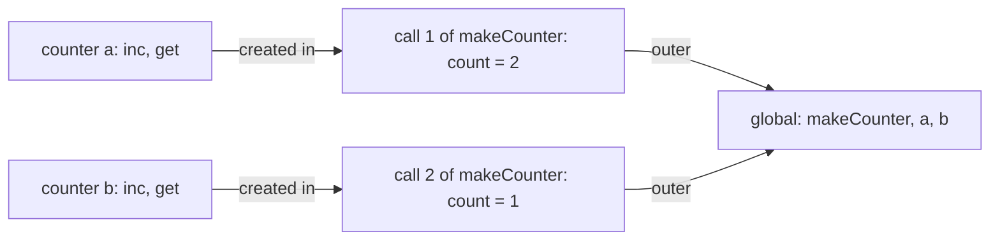

<!-- read-first -->
> [!info] Read first
> [[call-stack|Call stack]]
<!-- /read-first -->

> [!abstract] Today
> Scope and [[closure|closures]] in JavaScript: how a name is looked up, why an inner function keeps its outer variables alive, what `var`, `let` and `const` change, the [[temporal-dead-zone|temporal dead zone]], and the loop bug. About 25 minutes: warm-up, lesson, puzzle.

## Warm-up

> [!question]- Your client gets `403` on an API call. Should it retry? And on `503`?
> Not on `403`: the server understood and refused, so the same request gets the same answer. On `503`, yes, with backoff and respecting `Retry-After`, as long as the request is safe to repeat. From [[2026-11-18-http|#5 · HTTP in depth]].

> [!question]- You call an `async` function. Which part of its body runs right away?
> Everything up to the first `await`. Then the caller gets a pending [[promise|promise]], and the rest runs later as a [[microtask-queue|microtask]]. Keep this in mind today: the rest of the function still sees all its local variables when it resumes, and that is a closure at work. From [[2026-11-11-event-loop|#1 · The event loop]].

> [!question]- Why does `def f(x, items=[])` remember items from earlier calls?
> The default value is evaluated once, when the `def` line runs, and the same list is reused by every call. Today you will use that same rule on purpose, to fix a closure bug in Python. From [[2026-11-12-python-object-model|#2 · Python's object model]].

## The idea

When your code says `count`, JavaScript has to decide **which** `count` you mean. The rule is short: it looks in the block you are in, then the block around that, and so on outward until the global scope. The nesting it follows is the nesting **in the source code**, where the function was written, not where it is called from. That is [[lexical-scope|lexical scope]].

A closure is what you get when you combine that rule with functions being values. A function can be returned, stored, or passed as a callback, and called long after the function that created it has returned. When that happens, its outer variables must still exist, because the lookup rule says they are in scope. So JavaScript keeps them alive. A closure is a function together with the variables it can see from where it was created.

Three facts carry this lesson:

1. **Scope is decided by where code is written.** You can read it off the page.
2. **A closure keeps variables, not values.** If the variable changes later, the closure sees the new value.
3. **Each call, and each block, gets fresh variables.** Two calls to the same function make two separate sets of locals, and so two separate closures.

## How it really works

### Environments and the outer link

The ECMAScript spec models scope with **[[ecmascript-environment-records|environment records]]**: a table from names to values. Every time code enters a new scope, the engine creates one:

- the global scope has one;
- every **call** of a function creates a new one for its parameters and locals;
- every **block** (`{ ... }`, a loop body) that declares `let`, `const` or `class` creates one.

Each record has a link to its **outer** record. Looking up a name means: check this record; if the name is not there, follow the outer link; repeat. If you reach the global record and still find nothing, you get `ReferenceError: x is not defined`.

The key step is what happens when a function is created. The spec stores the current environment in an internal slot of the new function object, called `[[Environment]]`. When the function is later called, the new environment for that call gets `[[Environment]]` as its outer link. It does not matter where the call happens. That single stored pointer is the whole mechanism of closures.



Normally a call's environment dies when the call returns, because nothing points to it any more. If a function created inside the call is still reachable, that function points to the environment, so the garbage collector keeps it. Nothing is copied. The variables simply stay where they were.

### var, let and const

The three keywords differ in **which** environment the name goes into and **when** it becomes usable.

| | Scope | Before its line runs | Reassign | Declared twice in one scope |
|---|---|---|---|---|
| `var` | the whole function (or global) | exists, value `undefined` | yes | allowed |
| `let` | the nearest block | exists, but any access throws `ReferenceError` | yes | `SyntaxError` |
| `const` | the nearest block | exists, but any access throws `ReferenceError` | no (`TypeError`) | `SyntaxError` |
| `function f() {}` | the function (the block, in strict mode) | exists, fully usable | yes | allowed at function level |

`var` ignores blocks. A `var` inside an `if` or a `for` belongs to the whole function. That one fact causes the classic loop bug.

`const` makes the **binding** constant, not the value. `const arr = []; arr.push(1)` is fine; `arr = []` throws. If you need a frozen object, use `Object.freeze`, and know that it is shallow.

### Hoisting and the temporal dead zone

Before any code in a scope runs, the engine creates every name declared in it. This is called [[hoisting|hoisting]]. What differs is the starting state:

- `var` names start as `undefined`;
- function declarations start as the finished function, so you can call them above the line that defines them;
- `let`, `const` and `class` names start **uninitialized**. From the start of the block until the declaration line runs, any read or write throws `ReferenceError`. That stretch is the temporal dead zone (TDZ).

The spec says these variables are created when the scope starts but "may not be accessed in any way until the variable's LexicalBinding is evaluated." Predict the output before you read the comments:

```js run
function demo() {
  try { console.log(x); } catch (e) { console.log(e.name); }        // ReferenceError
  console.log(typeof notDeclaredAnywhere);                            // undefined
  try { typeof x; } catch (e) { console.log('typeof throws too:', e.name); }  // typeof throws too: ReferenceError
  let x = 1;

  console.log(v);                    // undefined: var is created early with value undefined
  var v = 2;

  console.log(hoisted());            // functions are hoisted whole
  function hoisted() { return 'functions are hoisted whole'; }
}
demo();
```

Note the third line. `typeof` on a name that does not exist at all is safe and gives `"undefined"`. `typeof` on a `let` in its dead zone throws. The engine knows the name exists; it refuses to let you touch it yet.

Why have a dead zone at all? Because the alternative, `undefined` before the line runs, hides bugs. A `const` that could be read as `undefined` and then as its real value would not be constant.

## Example

A counter with private state. Nothing outside the factory can reach `count` except through the two functions:

```js run
function makeCounter() {
  let count = 0;
  return {
    inc() { count += 1; return count; },
    get() { return count; },
  };
}

const a = makeCounter();
const b = makeCounter();
a.inc(); a.inc();
b.inc();
console.log(a.get(), b.get());   // 2 1   each call made its own count
console.log(a.count);            // undefined   count is a variable, not a property

let greeting = 'hello';
const say = () => greeting;
greeting = 'bye';
console.log(say());              // bye   the closure reads the variable now, not the value it had then
```

`inc` and `get` from the same call **share** one `count`, because they were created in the same environment. That is how modules, private state and React hooks work underneath.

### The loop-and-setTimeout bug

Predict the output:

```js run
for (var i = 0; i < 3; i++) {
  setTimeout(() => console.log('var', i));
}
for (let j = 0; j < 3; j++) {
  setTimeout(() => console.log('let', j));
}
// var 3
// var 3
// var 3
// let 0
// let 1
// let 2
```

With `var`, there is **one** `i` for the whole function. The three callbacks are closures over that same variable. They run later, as tasks from the [[task-queue|task queue]], after the loop has finished and left `i` at 3. All three read 3.

With `let`, the spec gives each iteration of a `for` loop **its own copy** of `j`. At the end of each iteration the engine makes a new environment and copies the current value into it, then runs the increment on the new copy. So each callback closes over a different `j`, holding 0, 1 and 2.

The fixes, oldest to newest:

```js run
// 1. An IIFE: call a function per iteration, so each call has its own parameter k
for (var k = 0; k < 3; k++) ((k) => setTimeout(() => console.log('iife', k)))(k);

// 2. Pass the value, not the variable: setTimeout forwards extra arguments
for (var m = 0; m < 3; m++) setTimeout((m) => console.log('arg', m), 0, m);

// 3. Use let (the real fix)
```

All three work for the same reason: they make a new variable per iteration, so each closure has its own.

### The same idea in Python

Python's scopes are functions, modules and classes, not blocks, and its loop variable is one variable for the whole loop. So Python has the `var` version of the bug, and a classic fix borrowed from the warm-up:

```py run
fns = [lambda: i for i in range(3)]
print([f() for f in fns])            # [2, 2, 2]   one i, read when called

fns = [lambda i=i: i for i in range(3)]
print([f() for f in fns])            # [0, 1, 2]   defaults are evaluated once, at definition

def counter():
    count = 0
    def inc():
        nonlocal count               # without this, count += 1 raises UnboundLocalError
        count += 1
        return count
    return inc

c = counter()
c()
print(c())                                              # 2
print(c.__code__.co_freevars, c.__closure__[0].cell_contents)   # ('count',) 2
```

`__closure__` shows the mechanism directly: CPython keeps each captured variable in a **cell**, and both the outer function and the closure point at the same cell. [Step through it on Python Tutor](https://pythontutor.com/visualize.html#code=def%20counter%28%29%3A%0A%20%20%20%20count%20%3D%200%0A%20%20%20%20def%20inc%28%29%3A%0A%20%20%20%20%20%20%20%20nonlocal%20count%0A%20%20%20%20%20%20%20%20count%20%2B%3D%201%0A%20%20%20%20%20%20%20%20return%20count%0A%20%20%20%20return%20inc%0A%0Ac%20%3D%20counter%28%29%0Ac%28%29%0Aprint%28c%28%29%29&mode=display&py=3) to watch the frame of `counter` disappear while `count` survives.

## In the wild

Go had the `var` version of this bug for over a decade. A `for` loop in Go declared one variable for the whole loop, so a closure or a goroutine started inside the loop saw only the last value. The Go team's post [Fixing For Loops in Go 1.22](https://go.dev/blog/loopvar-preview) calls it one of the most common Go mistakes and says it caused production problems at many companies, including a publicly documented issue at Let's Encrypt. There the capture was spread across several functions: the author copied one loop variable, but a helper took pointers into the other one, which also needed a copy. The post explains why checkers could not catch it reliably, and Go 1.22 changed the language so each iteration gets a new variable, the same choice JavaScript made for `let` in ES2015.

## Traps

- **Closures capture variables, not values.** If the variable changes before the closure runs, the closure sees the change. To freeze a value, make a new variable per iteration or call.
- **`var` ignores blocks.** A `var` inside `if`, `for` or `{}` belongs to the whole function.
- **Shadowing into the dead zone.** `let x = 1; { console.log(x); let x = 2; }` throws. The inner `let x` is hoisted to the top of its block, so inside the block `x` means the inner one, which is not ready yet.
- **`const` is not [[mutability|immutable]].** It locks the name, not the object.
- **Stale closures in React.** `useEffect(() => { setInterval(() => setCount(count + 1), 1000) }, [])` keeps showing 1: the interval callback closed over the `count` from the first render, which is always 0. Use the updater form `setCount(c => c + 1)` or list `count` in the dependencies.
- **Closures keep memory alive.** A long-lived callback (an event listener, a timer, a cache) keeps its whole environment reachable. In V8 (Chrome, Node), closures made in the same scope share one context object, so a large array used only by a short-lived callback can stay alive as long as a long-lived sibling closure does. Remove listeners and clear timers you no longer need.
- **Python's `UnboundLocalError`.** Assigning to a name anywhere in a function makes it local for the whole function. Use `nonlocal` (or `global`) to assign to an outer variable.

## How interviews ask it

> [!question]- "What is a closure? Give an example of where you would use one."
> A closure is a function together with the variables from the scope where it was created. It can keep using them after that scope has returned. Mechanically, the function object stores a reference to its creating environment, and each call of the function gets that environment as its outer scope. Uses: private state (a counter or a module that exposes only some functions), function factories (`makeAdder(5)`), callbacks and event handlers that need context, and helpers like `once`, `memoize` and `debounce` that keep state between calls.

> [!question]- "What does this print: `for (var i = 0; i < 3; i++) setTimeout(() => console.log(i))`? How do you fix it?"
> `3 3 3`. `var` makes one function-scoped `i`, every callback closes over that same variable, and the callbacks run after the loop has finished, when `i` is 3. Fix it with `let`, which creates a new binding per iteration, so it prints `0 1 2`. Older fixes: wrap the body in an immediately invoked function that takes `i` as a parameter, or pass `i` as the third argument to `setTimeout`. All of them give each callback its own variable.

> [!question]- "What is the difference between `var`, `let` and `const`? What is hoisting?"
> `var` is function-scoped, can be redeclared, and is created at the start of its function with the value `undefined`. `let` and `const` are block-scoped, cannot be redeclared in the same scope, and are created at the start of their block but cannot be touched until their line runs; touching them earlier throws a `ReferenceError` (the temporal dead zone). `const` also forbids reassigning the name, though the object it points to can still change. Hoisting is the name for "declarations are processed before the code in a scope runs"; it applies to all of them, with different starting states. Function declarations are hoisted with their body.

## Build it

Write three helpers, each in a few lines, each using a closure for its state:

1. `once(fn)`: returns a function that calls `fn` the first time and returns the first result on every later call.
2. `memoize(fn)`: caches results in a `Map` keyed by the argument; count how often `fn` really runs.
3. `debounce(fn, ms)`: returns a function that waits until it has not been called for `ms` milliseconds, then calls `fn` with the last arguments. Test it with a loop of five quick calls and check that `fn` runs once.

Then answer: where does each helper keep its state, and how many separate states exist if you call `once` twice on the same function?

## Check yourself

> [!question]- `const items = []; items.push(1);` Does this throw? What about `items = [1]`?
> The `push` works: `const` only stops you from pointing the name `items` at something else. `items = [1]` throws a `TypeError`, because that is a reassignment.

> [!question]- You call `makeCounter()` twice and increment the first counter three times. What does the second counter show, and why?
> 0. Each call of `makeCounter` creates a new environment with its own `count`, and each returned function is linked to the environment of the call that created it.

> [!question]- Why does `let x = 1; { console.log(x); let x = 2; }` throw instead of printing 1?
> The inner `let x` belongs to the block and is hoisted to its top, so inside the block the name `x` refers to the inner variable. That variable is in its temporal dead zone until its `let` line runs, so reading it throws a `ReferenceError`.

## Puzzle

Today: [[valid-palindrome|Valid Palindrome]], the first [[two-pointers|two-pointer]] puzzle of the week. Yesterday's [[product-of-array-except-self|Product of Array Except Self]] has its solution.

## Market word: Go

In 20 of 1,230 Canadian entry-level job posts in the last gap report (week to 2026-11-16). [[go-language|Go]] is a compiled, statically typed language from Google, built for servers and tools: fast builds, one static binary to deploy, and cheap [[concurrency-vs-parallelism|concurrency]] through goroutines and channels. Platform, DevOps and backend roles ask for it because much of cloud infrastructure is written in it, including Docker and Kubernetes. It connects to today directly: Go has closures with the same rules, and until Go 1.22 its loops had the `var` bug from this lesson.
