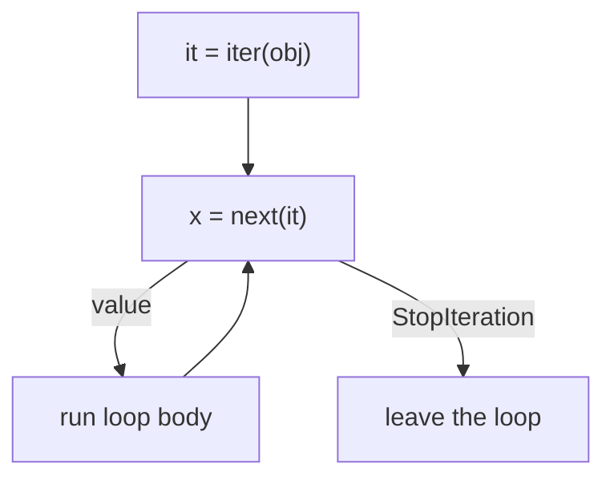

<!-- read-first -->
> [!info] Read first
> [[call-stack|Call stack]] · [[mutability|Mutability]]
<!-- /read-first -->

> [!abstract] Today
> The [[iterator|iterator]] protocol behind every Python `for` loop, [[generator|generators]] and `yield`, and
> [[lazy-evaluation|lazy]] pipelines that use almost no memory. About 25 minutes: warm-up, lesson, puzzle.

## Warm-up

> [!question]- Your code does `for x in a: if x in b: ...`. What is the cost if `b` is a list of size m, and if it is a set?
> With a list, each `in` scans up to m items, so O(n · m). With a set, each `in` is O(1) on average, so [[big-o-notation|O(n)]]. From [[2026-11-19-big-o-for-real|#6 · Big-O for real]]. Keep it in mind today: a lazy pipeline changes memory, not the cost of each step.

> [!question]- `new = old.copy()` on a list of lists, then you change `new[0][0]`. Does `old` change?
> Yes. `.copy()` is shallow, so both outer lists hold the same inner lists. From [[2026-11-12-python-object-model|#2 · Python's object model]]. Today's version of the same idea: two names for one iterator share one position.

> [!question]- Which runs first after a script ends: a `setTimeout(fn, 0)` callback or a `.then` callback?
> The `.then` callback, because it is a microtask and [[microtask-queue|microtasks]] drain before the next task. From [[2026-11-11-event-loop|#1 · The event loop]]. Notice the pattern: `await` also pauses a function and resumes it later, which is what `yield` does today.

## The idea

Most loops use a list. A list holds **all** its items in memory at once. That is a problem when the data is big (a 20 GB log file), slow to produce (rows from a database), or never ends (a stream of events).

Python's answer is the iterator: an object that gives you **the next item when you ask**, and remembers where it is. It never needs the whole sequence in memory. A generator is the easy way to write one: a function that can pause in the middle and continue later.

Three facts carry this lesson:

1. **A `for` loop is a `next()` loop.** Nothing else is going on underneath.
2. **An iterator is used up.** It only moves forward, and once it is finished it stays finished.
3. **Lazy means "on demand".** Work happens when the consumer asks, not when you write the code.

## How it really works

### The protocol

Two words, two jobs:

- An **iterable** is anything you can ask for an iterator: lists, strings, dicts, files, `range`. It has `__iter__`.
- An **iterator** has `__next__`, which returns the next item or raises `StopIteration`. Its `__iter__` returns itself.

```py run
nums = [10, 20, 30]
it = iter(nums)            # nums.__iter__() gives a fresh iterator
print(next(it), next(it), next(it))    # 10 20 30
try:
    next(it)
except StopIteration:
    print("finished")      # finished
```

The loop `for x in nums: body` is defined as: call `iter(nums)` once, then call `next()` repeatedly, run the body for each result, and stop quietly on `StopIteration`. This is the protocol from [PEP 234](https://peps.python.org/pep-0234/), and it is why the same `for` works on lists, files, dicts and your own classes.



Because the loop calls `iter()` on whatever you give it, passing an iterator works too. Its `__iter__` returns itself, so the loop continues from the current position. Predict the output:

```py run
it = iter([1, 2, 3, 4])
for x in it:
    print(x)
    if x == 2:
        break
print(list(it))            # [3, 4]   the loop left the iterator mid-way
print(list(it))            # []       now it is used up
```

### Writing an iterator by hand

```py run
class Countdown:
    def __init__(self, start):
        self.n = start
    def __iter__(self):
        return self
    def __next__(self):
        if self.n <= 0:
            raise StopIteration
        self.n -= 1
        return self.n + 1

print(list(Countdown(3)))  # [3, 2, 1]
```

That is eight lines to count down. The state (`self.n`) is saved by hand. A generator saves it for you.

### Generators: functions that pause

If a function body contains `yield`, calling it does **not** run the body. It returns a generator object, which is an iterator. Each `next()` runs the body until the next `yield`, hands out the value, and freezes the function there with all its locals.

```py run
def countdown(n):
    print("starting")
    while n > 0:
        yield n            # pause: give n out, keep everything
        n -= 1
    print("done")

g = countdown(2)           # prints nothing
print(next(g))             # starting, then 2
print(next(g))             # 1
print(list(g))             # done, then []
```

Read the order of the prints. The body started only on the first `next()`. When the body ended, Python raised `StopIteration` for you.

A normal function's frame disappears when it returns. A generator's frame is **kept on the heap** while it is paused, so it can be resumed from anywhere, with no depth added to the [[call-stack|call stack]]. This is the same trick `async` functions use at an `await`. [PEP 255](https://peps.python.org/pep-0255/) introduced it ([[pep-255-simple-generators|notes on the PEP]]).

You can also see the state directly:

```py run
import inspect

def g():
    yield 1
    yield 2

gen = g()
print(inspect.getgeneratorstate(gen))   # GEN_CREATED
next(gen)
print(inspect.getgeneratorstate(gen))   # GEN_SUSPENDED
list(gen)
print(inspect.getgeneratorstate(gen))   # GEN_CLOSED
```

### Generator expressions

A list comprehension in square brackets builds the whole list. The same thing in parentheses is a generator:

```py run
import sys
as_list = [n * n for n in range(1_000_000)]
as_gen = (n * n for n in range(1_000_000))
print(sys.getsizeof(as_list) > 1_000_000)   # True   millions of bytes
print(sys.getsizeof(as_gen) < 1_000)        # True   a few hundred bytes, for any length
print(sum(as_gen))                          # 333332833333500000
```

When a generator expression is the only argument of a call, you can drop the extra parentheses: `sum(n * n for n in data)`.

### Lazy pipelines

Chain generators and each item travels through all stages before the next item starts. Nothing is stored between stages.

```py run
def numbers():
    n = 0
    while True:                # an endless source
        yield n
        n += 1

def evens(source):
    for n in source:
        if n % 2 == 0:
            yield n

def squares(source):
    for n in source:
        yield n * n

from itertools import islice
print(list(islice(squares(evens(numbers())), 5)))   # [0, 4, 16, 36, 64]
```

The source is endless, and this finishes anyway, because `islice` stops pulling after five items. An eager version (build a list of evens, then a list of squares) would never end.

The standard `itertools` module is a toolbox of such pieces: `islice`, `chain`, `takewhile`, `groupby`, `tee`, `batched` (Python 3.12+).

### Reading big files

A file object is an iterator over lines. This reads one line at a time, so a 20 GB file needs only memory for one line:

```py run
import tempfile, os
path = os.path.join(tempfile.mkdtemp(), "log.txt")
with open(path, "w") as f:
    f.write("ok\nERROR disk full\nok\nERROR timeout\n")

def errors(path):
    with open(path) as f:
        for line in f:                    # lazy: one line at a time
            if line.startswith("ERROR"):
                yield line.rstrip()

print(list(errors(path)))   # ['ERROR disk full', 'ERROR timeout']
```

Note the `with` inside the generator: the file stays open while the generator is paused, and closes when the generator finishes or is closed.

### yield from and the value of return

`yield from other` hands over to another iterator and passes its values straight through. It was added in Python 3.3 (PEP 380), and it makes recursive generators simple:

```py run
def flatten(items):
    for item in items:
        if isinstance(item, list):
            yield from flatten(item)      # delegate to the nested call
        else:
            yield item

print(list(flatten([1, [2, [3, 4]], 5])))  # [1, 2, 3, 4, 5]
```

A `return value` inside a generator ends it, and the value rides on the `StopIteration` that ends the loop (`for` ignores it, but `yield from` hands it to you as the result of the expression).

## Example

Putting it together: the average of a numeric column in a huge CSV, in constant memory.

```py run
import csv, io

fake_file = io.StringIO("name,score\nana,80\nbo,90\ncy,100\n")

def scores(f):
    for row in csv.DictReader(f):         # DictReader is itself an iterator
        yield float(row["score"])

total = count = 0
for s in scores(fake_file):
    total += s
    count += 1
print(total / count)                       # 90.0
```

Memory use is one row, whether the file has three rows or three hundred million. The shape (read, transform, aggregate) is what data pipelines do. Pandas has `chunksize` and Spark has partitions for the same reason.

## Traps

- **One-shot.** `sum(gen)` twice gives the real answer, then `0`. A function that returns a generator can be consumed once. If you need two passes, make a list, or call the generator function again.
- **Silent exhaustion.** `if gen:` is always true: a generator object has no length and is never "empty" as a truth value. Use `next(gen, None)` to peek.
- **Late errors.** An exception in the body appears at the `next()` call that reached it, far from where the generator was created. Debugging pipelines means finding which stage raised.
- **Late binding in generator expressions.** Only the outermost iterable is evaluated at once. Everything else waits for the first `next()`:

```py run
x = 10
g = (x * i for i in range(3))   # range(3) is evaluated now; x is looked up later
x = 100
print(list(g))                  # [0, 100, 200]   it used the new x
```

- **`tee` and memory.** `itertools.tee` copies one iterator into several, but it buffers the items that one copy has seen and another has not. Far apart consumers can use as much memory as a list.
- **Not a list.** No `len()`, no indexing, no slicing with `[:3]`. Use `islice`.
- **Python-only habit.** JavaScript has the same idea (`function*`, `Symbol.iterator`, and async iterators for streams). The protocol differs: JavaScript's `next()` returns `{ value, done }` instead of raising an exception.

## How interviews ask it

> [!question]- "What is the difference between an iterable and an iterator? How does a `for` loop work?"
> An iterable can give you an iterator through `iter()`. An iterator has `__next__`, which returns the next item or raises `StopIteration`, and its `__iter__` returns itself. A `for` loop calls `iter()` once on the object, then calls `next()` until `StopIteration`. A list is an iterable that makes a new iterator each time; a generator or file object is an iterator, so it is used up after one pass.

> [!question]- "What does `yield` do, and why would you use a generator instead of returning a list?"
> `yield` pauses the function and hands a value to the caller; the function resumes at that point on the next `next()`, with its local variables intact. A generator produces values on demand, so memory stays constant however much data flows through, it can start producing before all the work is done, and it can model endless streams. Use a list when you need the whole result more than once, need `len()` or indexing, or the data is small.

> [!question]- "This function returns `sum(g)` and then `max(g)` for the same generator `g`. What is wrong?"
> The generator is exhausted by `sum`, so `max(g)` sees an empty iterator and raises `ValueError`. Either build a list once, or compute both in a single loop, or call the generator function again to get a fresh generator.

## Build it

1. Write `read_lines(path)` as a generator, then `grep(lines, word)` and `numbered(lines)` as generators that take another iterable. Chain them so that only the first 3 matching lines of a file are read, and check (with a counter or a print) that the rest of the file is never touched.
2. Write `batched(iterable, size)` yourself with `itertools.islice` in a `while True` loop. Test with a generator of 10 items and size 4: you should get lists of 4, 4 and 2.
3. Write a class with `__iter__` that returns a **new** iterator each time, and show that two `for` loops over it, one inside the other, both work. Then do the same with a class whose `__iter__` returns `self`, and see what breaks.

## Check yourself

> [!question]- `g = (n for n in range(3))`; `list(g)`; `list(g)`. What are the two results, and why?
> `[0, 1, 2]` and then `[]`. The first call consumed the generator and the second finds it finished.

> [!question]- A function has `yield` on its last line only. You call it and never call `next()`. Does any of its code run?
> No. Calling a generator function only creates the generator object. The body starts at the first `next()` (a `for` loop or `list()` does that for you).

> [!question]- You need the first 5 items of an endless generator. Why does `gen[:5]` fail, and what works?
> Generators do not support indexing or slicing. Use `list(itertools.islice(gen, 5))`, which pulls only five items.

## Puzzle

Today: [[two-sum-ii|Two Sum II]], the second [[two-pointers|two pointer]] puzzle of the week. Yesterday's [[valid-palindrome|Valid Palindrome]] has its solution.

## Market word: Kafka

In 16 of 1,230 Canadian entry-level job posts in the last gap report (week to 2026-11-16). [[kafka|Apache Kafka]] is a distributed log: services append events to topics, and other services read them at their own pace. Backend and data roles ask for it because event-driven systems and data pipelines are built on it. It connects to today directly: a Kafka consumer is an iterator over a stream that never ends. You pull records one at a time, keep track of your position (the offset), and process each record before taking the next, the same shape as the lazy pipeline above.
