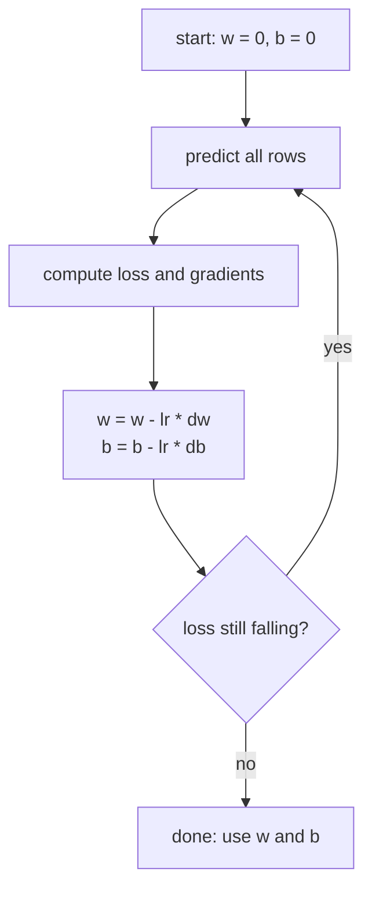

<!-- read-first -->
> [!info] Read first
> [[overfitting|Overfitting]] · [[mean-squared-error|Mean squared error]]
<!-- /read-first -->

> [!abstract] Today
> Build [[linear-regression|linear regression]] in plain Python: the loss, the slope of the loss, and
> [[gradient-descent|gradient descent]] step by step. About 25 minutes: warm-up, lesson, puzzle.

## Warm-up

> [!question]- `const items = []; items.push(1);` Does this throw? What about `items = [1]`?
> The `push` works: `const` only stops you from pointing the name `items` at something else. `items = [1]` throws a `TypeError`, because that is a reassignment. From [[2026-11-20-closures-and-scope|#7 · Closures and scope]]. A link to today: the names `w` and `b` below are rebound on every step, the opposite of a constant, while the data lists stay fixed.

> [!question]- A model's training error keeps falling as you make it more flexible. What usually happens to its validation error, and why?
> It falls at first, then rises. More flexibility lowers bias, but past some point the model fits the noise in the training data, so its variance grows faster than its bias shrinks. From [[2026-11-13-overfitting|#3 · Overfitting]]. A straight line is the least flexible model there is, so today you will see high bias and low variance.

> [!question]- After a script finishes, which runs first: a `setTimeout(fn, 0)` callback or a `.then` callback? Why?
> The `.then` callback. It is a microtask, and all [[microtask-queue|microtasks]] run as soon as the current task ends, before the loop takes the next task. From [[2026-11-11-event-loop|#1 · The event loop]]. Keep the idea of "a loop that repeats a small step until a condition holds": gradient descent is one too.

## The idea

You have pairs of numbers, such as hours studied and exam score. You want a rule that predicts a score from hours, including for a number of hours you have not seen. The simplest rule is a straight line:

```
prediction = w * x + b
```

`w` is the **weight** (slope): how much the prediction rises for one more unit of `x`. `b` is the **bias** or intercept: the prediction when `x` is 0. (This `b` is not the "bias" of the [[bias-variance-trade-off|bias-variance trade-off]]; the names collide, the ideas do not.)

Learning means choosing `w` and `b`. To choose, you need a way to say how bad a line is. That is the **loss**. Then you search for the line with the lowest loss. Three facts carry this lesson:

1. **A model is a function with knobs.** Training turns the knobs.
2. **A loss turns "bad" into a number.** For regression it is usually [[mean-squared-error|mean squared error]].
3. **Gradient descent turns the knobs using the slope of the loss.** No cleverness, just repeated small steps downhill.

## How it really works

### The data and the loss

Five points. Keep them, we use them all lesson.

```py run
xs = [1, 2, 3, 4, 5]
ys = [3, 5, 4, 7, 6]

def predict(w, b, x):
    return w * x + b

def mse(w, b):
    errors = [predict(w, b, x) - y for x, y in zip(xs, ys)]
    return sum(e * e for e in errors) / len(errors)

print(mse(0, 0))        # 27.0   the line y = 0 is far off
print(mse(1, 2))        # 0.8    the line y = x + 2 is much closer
```

The loss is a function of `w` and `b`. Fix `b = 2.6` and try different slopes:

```py run
xs = [1, 2, 3, 4, 5]
ys = [3, 5, 4, 7, 6]
def mse(w, b):
    return sum((w * x + b - y) ** 2 for x, y in zip(xs, ys)) / len(xs)

for w in (0, 0.4, 0.8, 1.2, 1.6):
    print(w, round(mse(w, 2.6), 2))
# 0 7.76
# 0.4 2.48
# 0.8 0.72
# 1.2 2.48
# 1.6 7.76
```

It is a bowl: the loss is lowest at one slope, and rises on both sides. Squaring the errors makes the bowl smooth. With two knobs it is a bowl in three dimensions, and the lowest point is the best line. For squared error and a straight line there is exactly one bottom and no other valleys, which is what makes this model friendly.

### Way 1: the formula

Because the bowl has a known shape, calculus gives the bottom directly. For one input:

```
w = sum((x - mean_x) * (y - mean_y)) / sum((x - mean_x)²)
b = mean_y - w * mean_x
```

```py run
xs = [1, 2, 3, 4, 5]
ys = [3, 5, 4, 7, 6]
n = len(xs)
mx, my = sum(xs) / n, sum(ys) / n
w = sum((x - mx) * (y - my) for x, y in zip(xs, ys)) / sum((x - mx) ** 2 for x in xs)
b = my - w * mx
print(round(w, 3), round(b, 3))    # 0.8 2.6
```

The fitted line is `y = 0.8x + 2.6`, and its loss is 0.72. The line always passes through the point of averages `(mean_x, mean_y)`; the formula for `b` says exactly that. With many inputs the same idea becomes the normal equation, `w = (XᵀX)⁻¹ Xᵀy`, which libraries solve for you. It is exact, but the cost grows quickly with the number of features.

### Way 2: gradient descent

Many models have no formula. Gradient descent needs only one thing: the **slope of the loss** for each knob. If increasing `w` a little raises the loss, then decrease `w`. The slope for the MSE of a line comes from calculus (the chain rule on the squared error):

```
d loss / d w = (2/n) * sum((prediction - y) * x)
d loss / d b = (2/n) * sum(prediction - y)
```

Then the update, repeated:

```
w = w - learning_rate * (d loss / d w)
b = b - learning_rate * (d loss / d b)
```



Here it is, with the first three steps printed. Predict first: at `w = 0, b = 0` every prediction is 0, which is too low, so both slopes of the loss are negative and both knobs should go up.

```py run
xs = [1, 2, 3, 4, 5]
ys = [3, 5, 4, 7, 6]

def mse(w, b):
    return sum((w * x + b - y) ** 2 for x, y in zip(xs, ys)) / len(xs)

def grad(w, b):
    n = len(xs)
    dw = sum(2 * (w * x + b - y) * x for x, y in zip(xs, ys)) / n
    db = sum(2 * (w * x + b - y) for x, y in zip(xs, ys)) / n
    return dw, db

print(grad(0, 0))                  # (-33.2, -10.0)

w, b, lr = 0.0, 0.0, 0.05
for step in range(1, 4):
    dw, db = grad(w, b)
    w -= lr * dw
    b -= lr * db
    print(step, round(w, 3), round(b, 3), round(mse(w, b), 3))
# 1 1.66 0.5 2.43
# 2 1.344 0.452 1.578
# 3 1.39 0.504 1.523

for _ in range(2000):
    dw, db = grad(w, b)
    w -= lr * dw
    b -= lr * db
print(round(w, 3), round(b, 3), round(mse(w, b), 3))   # 0.8 2.6 0.72
```

After 2,000 steps it arrives at the same `w = 0.8, b = 2.6` as the formula. Look at the first steps: the slope knob jumps to 1.66, overshoots its final value of 0.8, and comes back down while the intercept creeps up. The two knobs interact, which is why it takes many small steps and not one.

### The learning rate

The size of each step is the [[learning-rate|learning rate]]. This is the knob you set yourself, so it is worth seeing what it does.

```py run
xs = [1, 2, 3, 4, 5]
ys = [3, 5, 4, 7, 6]

def fit(lr, steps):
    w = b = 0.0
    n = len(xs)
    for _ in range(steps):
        dw = sum(2 * (w * x + b - y) * x for x, y in zip(xs, ys)) / n
        db = sum(2 * (w * x + b - y) for x, y in zip(xs, ys)) / n
        w -= lr * dw
        b -= lr * db
    return round(w, 3), round(b, 3)

print(fit(0.001, 100))   # (1.263, 0.429)  too small: far from 0.8, 2.6 after 100 steps
print(fit(0.05, 2000))   # (0.8, 2.6)      about right
```

With `lr = 0.25` the loss goes 615, 14,825, 358,170, 8.6 million, 209 million over five steps: each step overshoots the bottom by more than the last, so the loss grows instead of falling. If your loss ever becomes `nan` or `inf`, lower the learning rate first.

### Scale your features

The same problem appears if `x` is in large units. Suppose `x` is in thousands (1000 to 5000, say, square metres of land, not hours). The slope of the loss is thousands of times larger, so a rate that worked now explodes:

```py run
ys = [3, 5, 4, 7, 6]
big = [1000, 2000, 3000, 4000, 5000]

def fit(xs, lr, steps):
    w = b = 0.0
    n = len(xs)
    for _ in range(steps):
        dw = sum(2 * (w * x + b - y) * x for x, y in zip(xs, ys)) / n
        db = sum(2 * (w * x + b - y) for x, y in zip(xs, ys)) / n
        w -= lr * dw
        b -= lr * db
    return w, b

print(fit(big, 0.05, 5)[0] > 1e20)      # True   exploded within five steps

mean = sum(big) / 5
std = (sum((x - mean) ** 2 for x in big) / 5) ** 0.5
z = [(x - mean) / std for x in big]     # standardised: mean 0, spread 1
w, b = fit(z, 0.1, 200)
print(round(w, 3), round(b, 3))          # 1.131 5.0
```

**Standardising** (subtract the mean, divide by the standard deviation) puts every feature on the same footing, and the same loop converges in 200 steps. The fitted `b = 5.0` is the mean of `y`, because a standardised `x` is 0 on average. Note: compute the mean and standard deviation on the training rows only, and reuse them on new data, or you create the leakage from [[2026-11-13-overfitting|lesson 3]].

### How good is the line?

MSE is in squared units, so it is hard to judge alone. Compare it with the dumbest model, which always predicts the mean of `y`. That model's MSE is the variance of `y`, which is 2.0 here. The line's MSE is 0.72. The ratio gives **R²**:

```
R² = 1 - (line's squared error / squared error of always predicting the mean) = 1 - 0.72 / 2.0 = 0.64
```

R² is 1 for a perfect fit, 0 for "no better than the mean", and can go negative on new data if the line is worse than the mean. 0.64 reads: the line explains 64% of the variation in scores. Measure it on a validation set, not on the data you fitted, or [[overfitting|overfitting]] will make it look better than it is.

### More than one input

Nothing changes in the idea: `prediction = w1*x1 + w2*x2 + ... + b`, one weight per feature, and the gradient has one entry per weight. In code you use arrays (NumPy, scikit-learn's `LinearRegression`). The model is called linear because it is linear in the **weights**: adding a column `x²` still gives a linear model, and lets the line curve.

### The assumptions

The formula always returns a line. Whether the line is trustworthy depends on the data:

| Assumption | If it fails |
|---|---|
| The relationship is roughly linear | The line is wrong everywhere in a patterned way (look at a plot of errors against `x`) |
| Errors are independent | Time series with a trend: errors in neighbouring rows are alike, and confidence intervals lie |
| Errors have similar spread everywhere | Predictions are fine on average, but the uncertainty is wrong for large `x` |
| No near-copies among inputs | The individual weights swing wildly, though predictions stay stable |
| Errors roughly normal | Only matters for confidence intervals and tests on the weights, not for the fit itself |

## Example

One outlier, one very different line. Add a sixth point, `(6, 30)`, to our data:

```py run
def fit(xs, ys):
    n = len(xs)
    mx, my = sum(xs) / n, sum(ys) / n
    w = sum((x - mx) * (y - my) for x, y in zip(xs, ys)) / sum((x - mx) ** 2 for x in xs)
    return round(w, 3), round(my - w * mx, 3)

print(fit([1, 2, 3, 4, 5], [3, 5, 4, 7, 6]))            # (0.8, 2.6)
print(fit([1, 2, 3, 4, 5, 6], [3, 5, 4, 7, 6, 30]))     # (4.029, -4.933)
```

The slope jumps from 0.8 to 4.0 because of a single row. Squared error punishes a big miss so much that the line bends toward it to avoid it. The fix is not automatic: look at the point. Is it a typo, a different kind of case, or real? Then remove it, fix it, or use a loss that is less sensitive (Huber, absolute error).

## Traps

- **Learning rate too high, or unscaled features.** The loss becomes `nan`. Standardise, then lower the rate.
- **Judging by training error only.** A line with 50 features and 60 rows fits the training rows well and does badly on new ones. Use a [[train-validation-test-split|validation split]].
- **Extrapolating.** The line says 7.4 for `x = 6`, but the data stopped at 5. Far outside the range it is a guess dressed as a number.
- **Reading weights as causes.** A weight describes a pattern in this sample. It does not say that changing `x` would change `y`.
- **Wrong gradient, still "trains".** A sign error in the gradient code makes the loss rise; a scale error makes it slow. Compare to a numeric estimate (below).
- **Two meanings of "bias".** The intercept `b` and the bias in bias-variance are different things.

## How interviews ask it

> [!question]- "Walk me through how linear regression is trained with gradient descent."
> Start with weights at zero (or small random numbers). Predict every row, and compute the loss, the mean of the squared errors. Compute the gradient: the slope of the loss for each weight. Move every weight a small step against its gradient, scaled by the learning rate. Repeat until the loss stops falling. Because the loss for a linear model is a single smooth bowl, it reaches the same answer as the closed-form solution if the learning rate is small enough and the features are on similar scales.

> [!question]- "Your training loss is `nan` after a few steps. What do you check?"
> First the learning rate: too large, each step overshoots further than the last and the numbers overflow, so lower it by about 10 times. Second the feature scales: a feature in the thousands makes the gradient huge, so standardise the inputs. Third the data, for missing values or infinities, and the gradient code, by comparing it with a numeric estimate on a few points.

> [!question]- "When would you use the closed form instead of gradient descent?"
> When the data is small to medium and the number of features is modest, the closed form (normal equation or a library solver) gives the exact answer in one step with no learning rate to tune. Gradient descent wins when there are very many rows or features, when the data does not fit in memory (use mini-batches), or when the model has no closed form, as in neural networks.

## Build it

1. Write `fit_closed_form(xs, ys)` and `fit_gd(xs, ys, lr, steps)`. For the five points they must agree to 3 decimals. Add the assert.
2. Add a **gradient check**: compute `(mse(w + h, b) - mse(w - h, b)) / (2h)` with `h = 1e-6` and compare it with your `grad`. At `(0, 0)` the first slope should be about `-33.2`. A function like this is the best unit test for training code.
3. Record the loss at every step and find the first step where it falls by less than `1e-6`. Use that as a stopping rule instead of a fixed 2,000.
4. Generate 200 points from `y = 2x + 1 + noise`, split them 150/50, fit on the 150, and report R² on both parts. Then repeat with 5 training points and watch the gap.

```py run
xs = [1, 2, 3, 4, 5]
ys = [3, 5, 4, 7, 6]
def mse(w, b):
    return sum((w * x + b - y) ** 2 for x, y in zip(xs, ys)) / len(xs)
def grad(w, b):
    n = len(xs)
    return (sum(2 * (w * x + b - y) * x for x, y in zip(xs, ys)) / n,
            sum(2 * (w * x + b - y) for x, y in zip(xs, ys)) / n)

h = 1e-6
num_dw = (mse(h, 0) - mse(-h, 0)) / (2 * h)
num_db = (mse(0, h) - mse(0, -h)) / (2 * h)
print(round(num_dw, 3), round(num_db, 3))    # -33.2 -10.0
print(grad(0, 0))                            # (-33.2, -10.0)
```

## Check yourself

> [!question]- Why does gradient descent subtract the gradient?
> The gradient points toward the steepest increase of the loss. Moving the opposite way lowers the loss.

> [!question]- You multiply one feature by 1,000 (kilometres to metres). What happens to the best fit, and to gradient descent?
> The best line's predictions stay the same; the weight for that feature becomes 1,000 times smaller. But gradient descent now sees a gradient about 1,000 times larger for that weight, so the same learning rate may diverge. That is why you standardise features first.

> [!question]- Your model has R² = 0.95 on the training rows and 0.40 on the validation rows. What does it tell you?
> The model is overfitting: it has learned the quirks of the training sample. Reduce the number of features, get more data, or add regularisation (lesson 27), and judge by the validation score.

## Puzzle

Today: [[3sum|3Sum]], the third [[two-pointers|two pointer]] puzzle. It reuses yesterday's [[two-sum-ii|Two Sum II]], which now has its solution.

## Market word: integration testing

In 17 of 1,075 Canadian entry-level job posts in the last gap report (week to 2026-11-23). [[integration-testing|Integration testing]] checks that real parts of a system work together: your code with an actual database, one service calling another, or a whole pipeline from data to result. Backend, data and QA roles ask for it because most production bugs sit in the seams between parts that each passed their own [[unit-testing|unit tests]]. It connects to today directly: unit test the loss and the gradient (the numeric check above), then add one integration test that fits a tiny dataset like our five points and asserts that `w` is about 0.8 and `b` about 2.6.
